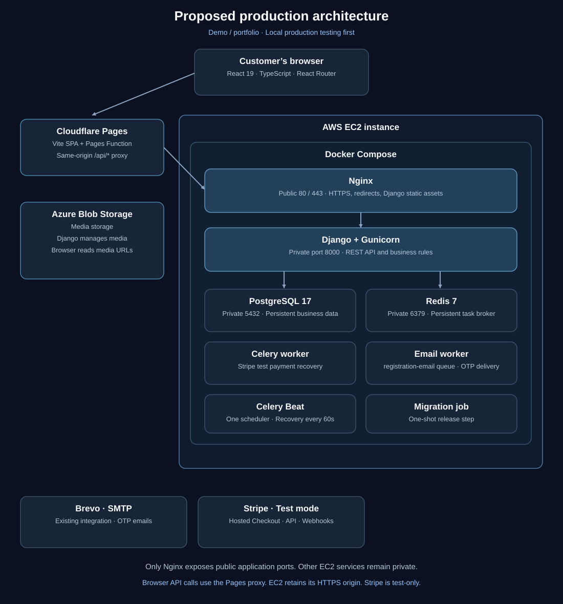

# Production deployment architecture

## Scope and status

Proposed demo/portfolio deployment, recorded on 2026-10-16. Local production
verification comes first; public frontend deployment is deferred. No domain has
been purchased. This document does not claim that production infrastructure exists.

The frontend is an implemented React CSR SPA. The backend already integrates
PostgreSQL, Redis, Celery workers, Beat, Azure Blob Storage, and test-only Stripe
Checkout. Cloud settings
were not inspected. Brevo is the existing email provider and integration, as confirmed by the project
owner. Provider account configuration was not inspected.
The backend production runtime image is defined in `Dockerfile.prod` with
Gunicorn. Production Compose and the backend Nginx TLS configuration are
now defined. Container startup, certificates, runtime verification, public hosting,
and deployment automation remain pending. The image alone is not a deployed production stack.

## Stack and hosting

| Layer          | Stack / host                                     | Responsibility                                                                                       |
| -------------- | ------------------------------------------------ | ---------------------------------------------------------------------------------------------------- |
| Frontend       | React 19, TypeScript, Vite, React Router         | Existing browser-rendered SPA; builds to `dist`                                                      |
| Static hosting | Cloudflare Pages, proposed                       | HTTPS frontend delivery; AWS Amplify is an alternative                                               |
| Backend host   | AWS EC2 with Docker Compose, proposed            | Initial single-server demo deployment                                                                |
| Reverse proxy  | Nginx, proposed                                  | HTTPS termination, API forwarding, Django static assets                                              |
| Application    | Gunicorn runtime image; Django 6 and DRF         | Production API process                                                                               |
| Database       | PostgreSQL 17                                    | Proposed private container and persistent volume; version matches development                        |
| Broker         | Redis 7                                          | Private Celery broker with persistence                                                               |
| Workers        | Celery default worker and dedicated email worker | Payment recovery and registration/password-change OTP delivery                                       |
| Scheduler      | One Celery Beat instance                         | Existing payment recovery dispatch every 60 seconds                                                  |
| Media          | Azure Blob Storage through django-storages       | Existing integration; verify deployment configuration                                                |
| Email          | Brevo via Django SMTP backend                    | Existing provider and email integration; verify environment-specific configuration during deployment |
| Payments       | Stripe hosted Checkout and signed webhooks       | Existing test-only integration; no real payments                                                     |

EC2 region and size remain undecided. Measure API, worker, database, and broker
memory together before selecting a size. Confirm AWS service eligibility, credit
balance, expiry, and ongoing cost before provisioning; credits are temporary.

## How the proposed production setup would look

Each enclosing box represents a hosting boundary. Everything inside Docker
Compose runs as containers on the same EC2 virtual machine. Cloudflare Pages,
Azure Blob Storage, Brevo, and Stripe run outside that machine.

**Connections between the boundaries**

- The browser downloads the frontend from Pages, sends HTTPS API requests to
  Nginx, and reads Azure media URLs under the configured storage access policy.
- Nginx forwards API requests to Gunicorn and serves collected Django static
  assets. It does not serve the Pages frontend or proxy ordinary Azure media reads.
- Django reads/writes PostgreSQL, publishes OTP tasks to Redis, manages Azure
  media, and calls Stripe. Direct browser uploads are not introduced here.
- Beat publishes scheduled payment recovery tasks to Redis. The payment worker
  consumes the default queue, reconciles Stripe state, and updates PostgreSQL.
- The email worker consumes `registration-email`, checks OTP validity in
  PostgreSQL, and sends email through the existing Brevo SMTP integration.
- Stripe sends signed webhooks through Nginx to Django.

Only Nginx exposes public application ports; database, broker, application, and
worker services remain private. Internal port numbers above are proposed
container ports, not public endpoints. The same-site domain/authentication
requirement below must be resolved before public deployment.

## Domain and authentication decision

Prefer `app.example.com` for Pages and `api.example.com` for EC2, both over HTTPS
under one registrable domain. These are illustrative names, not actual endpoints.

The frontend Axios client sends credentials; backend refresh and registration
cookies use `SameSite=Lax`. A free `pages.dev` frontend calling an unrelated API
domain is cross-site. CORS alone will not enable those cookies. The free URL can
preview the interface, but authenticated deployment still requires a domain or
routing decision. Choose same-site custom subdomains or design and verify a
same-origin API proxy before publishing. Cookie policy changes are not approved
by this document.

Configure exact CORS origins, allowed hosts, Stripe frontend origin, applicable
CSRF protections, and trusted proxy HTTPS handling. Nginx must overwrite forwarded
headers; Gunicorn must not be publicly reachable. Verify login, refresh, logout,
and registration cookies through the proxy.

## Container and operational boundaries

Retain backend `Dockerfile.dev` and `compose.dev.yaml`. `Dockerfile.prod` now
defines the runtime image; `compose.prod.yaml` and `deploy/nginx.conf.template` now define orchestration
and HTTPS proxying. Frontend hosting remains separate on Pages. A separate
`collectstatic` job prepares the static volume before Nginx starts. Reuse one versioned
backend image for API, workers, Beat, and a controlled one-shot migration job.
Production must use Gunicorn rather than Django runserver, without source bind
mounts or development reload/dependencies. Frontend hosting needs compiled assets,
not a production frontend container.

Only Nginx publishes public application ports. PostgreSQL, Redis, Gunicorn, and
workers stay private. Do not publish pgAdmin. Run exactly one Beat instance and
preserve the dedicated `registration-email` queue consumer. API health alone does
not establish email delivery or worker health.

PostgreSQL and Redis need persistent volumes. Volumes do not protect against
host loss.
PostgreSQL owns business state; Redis is the broker. Broker payloads can contain
OTPs and addresses and require restricted access and retention.

Keep secrets outside Git and images. Frontend `VITE_*` values are public build-time
configuration; only the public API URL belongs there. Azure, database, SMTP,
Django, and Stripe secrets remain server-side. Collect Django static files for
Nginx separately from user media. Implement certificate renewal, health checks,
restart policies, bounded logs, and queue monitoring.

This single-host setup accepts backend downtime during host failure or some
releases. It does not offer high availability or automatic horizontal scaling.
Managed PostgreSQL such as RDS is a later option, especially before handling real
customer data. Kubernetes, load balancers, and managed Redis are outside the
initial demo scope.

## Local production verification plan

1. Run frontend checks and build; inspect `dist` with Vite preview. Preview is a
   local verification server, not the eventual production hosting service.
2. Implement and run backend production containers and Nginx locally with isolated
   demo credentials and persistent test data.
3. Verify API HTTPS certificate trust and proxy headers. Frontend/API cookie
   integration must be tested with the separately hosted frontend and the chosen
   same-site domain or verified routing arrangement. Hosted staging is deferred.
4. Verify route refreshes, login/refresh/logout, registration and password-change
   OTPs, media, and Stripe test checkout/recovery.
5. Verify restart persistence, controlled migrations, and
   application rollback. Reverting an image does not reverse database changes.
6. Before public hosting, resolve domain/auth routing, configure Pages SPA fallback
   and API build variable, and verify signed Stripe webhooks at
   `/api/shop/stripe/webhook/`. Local reconciliation does not prove webhook delivery.

## Source references

- [Frontend build scripts](../../frontend/package.json), [entry point](../../frontend/src/app/main.tsx), [router](../../frontend/src/app/router.tsx), and [API client](../../frontend/src/app/api/axios.ts)
- [Backend development Compose](../../backend/compose.dev.yaml) and [Docker guide](../../backend/docs/docker-development.md)
- [Backend settings](../../backend/ecommerce_backend/settings.py) and [authentication views](../../backend/apps/authentication/views.py)
- [Stripe test contract](../../backend/docs/checkout/stripe-api.md)
- [Diagram index](../diagrams/README.md) and [diagramming specification](../diagrams/diagramming-specification.md)

Source links assume sibling frontend/backend/docs checkouts and may not resolve
when viewing only this repository online.

### Production image implementation

See the [backend production image guide](../../backend/docs/docker-production.md)
for build and inspection commands. Frontend production build, type-check, and lint
passed; the project owner confirmed testing the frontend preview on port 4173.

The production image built successfully. Isolated checks verified Gunicorn 26.2.0,
non-root UID/GID 10001, dependency consistency, Django system checks, and absence
of `.env*` files under `/app`. Database and integration tests remain pending.

### Production Compose implementation

The backend defines production Compose with separate development/production
projects and volumes, private service ports, migration/static collection jobs,
Nginx TLS termination, and production Django settings. Nginx serves backend
routes and assets; frontend hosting is separate. The overview image shows the
planned public topology and omits the static collection release job. Follow the
[backend run guide](../../backend/docs/docker-production.md) for certificate, build,
and startup commands. Containers have not been started for this step; the owner
will run and test them. No business endpoint or payload contract was changed.

### Disposable portfolio reset

The optional maintenance image contains taxonomy and seed source images; regular
API images exclude them. The `reset-demo.sh` wrapper validates targets, asks for
confirmation, stops application services, clears the dedicated broker, resets and
reseeds the schema/media, and restarts services only after success. `--dry-run`
performs preflight without
service shutdown or data deletion. Production settings now honor the explicit
`ALLOW_DEV_RESET` environment toggle (default false). See the maintained
[reset workflow](../diagrams/specific-business-processes/development/reset-development.md)
and [backend run guide](../../backend/docs/docker-production.md).
