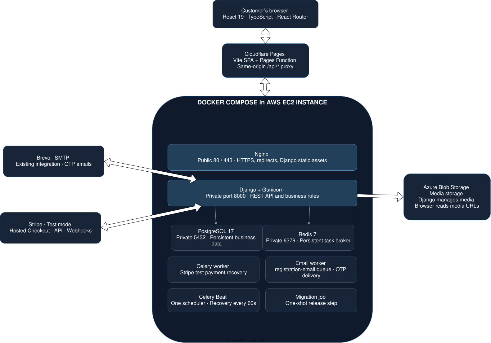

# Production deployment architecture

This guide explains the implemented hosting configuration: the browser downloads
the website from Cloudflare Pages, and backend services run on one EC2 server.
It describes source configuration, not evidence that any particular live server
has the right credentials, DNS, certificates, or healthy services.

## Follow one request

1. The browser loads frontend assets from Pages.
2. A request to the website's `/api/...` path reaches its Pages Function, which
   forwards it to the configured backend HTTPS origin.
3. Nginx accepts HTTPS and forwards the API request to Gunicorn/Django privately.
4. Django checks permissions and business rules, then reads or changes PostgreSQL.
5. The response returns through Nginx and Pages. The browser sees the frontend
   hostname, including for host-only authentication cookies.

A **reverse proxy** receives public requests on behalf of another service. A
**container** runs a service from its built image. A **volume** retains data when
a container is replaced; it does not protect against losing the server.

## Stack and hosting

| Layer          | Stack / host                                     | Responsibility                                                                                       |
| -------------- | ------------------------------------------------ | ---------------------------------------------------------------------------------------------------- |
| Frontend       | React 19, TypeScript, Vite, React Router         | Existing browser-rendered SPA; builds to `dist`                                                      |
| Static hosting | Cloudflare Pages + API Function                  | Selected frontend hosting and same-origin API forwarding                                             |
| Backend host   | AWS EC2 with Docker Compose                      | Owner-deployed single-server demo                                                                    |
| Reverse proxy  | Nginx                                            | HTTPS termination, API forwarding, Django static assets                                              |
| Application    | Gunicorn runtime image; Django 6 and DRF         | Production API process                                                                               |
| Database       | PostgreSQL 17                                    | Private container and persistent volume                                                              |
| Broker         | Redis 7                                          | Private Celery broker with persistence                                                               |
| Workers        | Celery default worker and dedicated email worker | Payment recovery and registration/password-change OTP delivery                                       |
| Scheduler      | One Celery Beat instance                         | Existing payment recovery dispatch every 60 seconds                                                  |
| Media          | Filesystem volume, served by Nginx               | Selected deployment storage; Azure remains an optional integration                                   |
| Email          | Brevo via Django SMTP backend                    | Existing provider and email integration; verify environment-specific configuration during deployment |
| Payments       | Stripe hosted Checkout and signed webhooks       | Existing test-only integration; no real payments                                                     |

## Hosting boundaries

Each enclosing box represents a hosting boundary. Everything inside Docker
Compose runs as containers on the same EC2 virtual machine. Cloudflare Pages,
Azure Blob Storage, Brevo, and Stripe run outside that machine.

**Connections between the boundaries**

- The browser downloads the frontend from Pages and sends same-origin `/api/*`
  calls to a Pages Function. That Function forwards requests/cookies to Nginx on
  the EC2 HTTPS origin. Browser media reads use the backend host in filesystem mode.
- Nginx forwards API requests to Gunicorn and serves collected Django static
  assets. It does not serve the Pages frontend or proxy ordinary Azure media reads.
- Django reads/writes PostgreSQL, publishes OTP tasks to Redis, persists media
  in the selected filesystem volume (Azure is optional), and calls Stripe. Direct browser uploads are not introduced here.
- Beat publishes scheduled payment recovery tasks to Redis. The payment worker
  consumes the default queue, reconciles Stripe state, and updates PostgreSQL.
- The email worker consumes `registration-email`, checks OTP validity in
  PostgreSQL, and sends email through the existing Brevo SMTP integration.
- Stripe sends signed webhooks through Nginx to Django.

Only Nginx exposes public application ports; database, broker, application, and
worker services remain private. Internal port numbers above are
container ports, not public endpoints. The same-site domain/authentication
configuration below must be applied before frontend deployment.

## Domain and authentication decision

Selected free layout: frontend at the assigned `*.pages.dev` hostname; API origin
at the backend HTTPS origin configured for that environment. A Pages Function proxies `/api/*`, keeping
the browser on the Pages origin. DuckDNS alone does not make the two hosts
same-site. The Function preserves host-only `SameSite=Lax` cookies and does not follow
redirects server-side. It forwards existing authentication payloads and cookie
policies; target-environment cookie checks remain part of deployment setup.

See the [API proxy process](../diagrams/specific-business-processes/deployment/same-origin-api-proxy.md)
and [frontend setup](../../frontend/docs/deployment/cloudflare-pages.md) for origin
configuration, failure handling, response caching and preview restrictions.

Configure exact CORS origins, allowed hosts, Stripe frontend origin, applicable
CSRF protections, and trusted proxy HTTPS handling. Nginx must overwrite forwarded
headers; Gunicorn must not be publicly reachable. Verify login, refresh, logout,
and registration cookies through the proxy.

## Container and operational boundaries

Local development uses `Dockerfile.dev` and `compose.dev.yaml`. `Dockerfile.prod`
defines the runtime image; `compose.prod.yaml` and `deploy/nginx.conf.template` define orchestration
and HTTPS proxying. Frontend hosting remains separate on Pages. A separate
`collectstatic` job prepares the static volume before Nginx starts. Reuse one versioned
backend image for API, workers, Beat, and a controlled one-shot migration job.
Production must use Gunicorn rather than Django runserver, without source bind
mounts or development reload/dependencies. Frontend hosting needs compiled assets,
not a production frontend container.

Only Nginx publishes public application ports. PostgreSQL, Redis, Gunicorn, and
workers stay private. Do not publish pgAdmin. Run exactly one Beat instance and
preserve the dedicated `registration-email` queue consumer. API health alone does
not establish email delivery or worker health.

PostgreSQL and Redis need persistent volumes. Volumes do not protect against
host loss.
PostgreSQL owns business state; Redis is the broker. Broker payloads can contain
OTPs and addresses and require restricted access and retention.

Keep secrets outside Git and images. Frontend `VITE_*` values are public build-time
configuration; only the public API URL belongs there. Azure, database, SMTP,
Django, and Stripe secrets remain server-side. Collect Django static files for
Nginx separately from user media. Implement certificate renewal, health checks,
restart policies, bounded logs, and queue monitoring.

This single-host setup accepts backend downtime during host failure or some
releases. It does not offer high availability or automatic horizontal scaling.
Managed PostgreSQL, Kubernetes, load balancers, and managed Redis are not part
of this configuration. High availability, backups, and monitoring need their own
operational design; the selected stack does not imply those capabilities.

## Source references

- [Frontend build scripts](../../frontend/package.json), [entry point](../../frontend/src/app/main.tsx), [router](../../frontend/src/app/router.tsx), and [API client](../../frontend/src/app/api/axios.ts)
- [Backend development Compose](../../backend/compose.dev.yaml) and [Docker guide](../../backend/docs/development/docker.md)
- [Backend settings](../../backend/ecommerce_backend/settings.py) and [authentication views](../../backend/apps/authentication/views.py)
- [Stripe test contract](../../backend/docs/api/checkout/stripe.md)
- [Diagram index](../diagrams/README.md) and [diagramming specification](../diagrams/diagramming-specification.md)

Source links assume sibling frontend/backend/docs checkouts and may not resolve
when viewing only this repository online.

### Production image implementation

See the [backend production image guide](../../backend/docs/operations/deployment.md#technical-appendix-production-docker-reference)
for build and inspection commands.

### Production Compose implementation

The backend defines production Compose with separate development/production
projects and volumes, private service ports, migration/static collection jobs,
Nginx TLS termination, and production Django settings. Nginx serves backend
routes and assets; frontend hosting is separate. The overview image shows the
high-level public topology and omits the static collection release job. Follow the
[backend run guide](../../backend/docs/operations/deployment.md#technical-appendix-production-docker-reference) for certificate, build,
and startup commands.

### Disposable portfolio reset

The optional maintenance image contains taxonomy and seed source images; regular
API images exclude them. The `reset-demo.sh` wrapper validates targets, asks for
confirmation, stops application services, clears the dedicated broker, resets and
reseeds the schema/media, and restarts services only after success. `--dry-run`
performs preflight without
service shutdown or data deletion. Production settings honor the explicit
`ALLOW_DEV_RESET` environment toggle (default false). See the maintained
[reset instructions](../../backend/docs/operations/reset-environment.md)
and [backend run guide](../../backend/docs/operations/deployment.md#technical-appendix-production-docker-reference).
