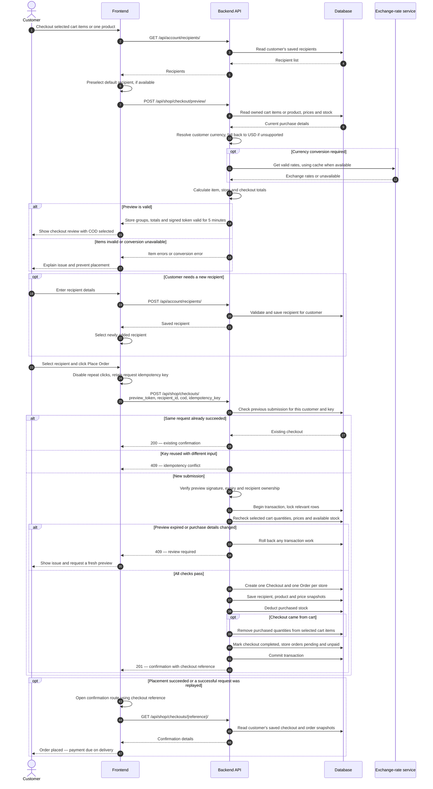

# Cash on Delivery checkout

**Status:** Approved API and workflow design; checkout endpoints and frontend
integration are not yet implemented. This diagram describes the intended behavior,
not a claim about the current application.

This sequence covers authenticated checkout from a product or selected cart items,
recipient selection, price review, atomic COD placement, and confirmation.

## Flow rules

- Every endpoint requires authentication. Only the owning customer can read their
  recipients, selected cart lines and checkout confirmation.
- Placement requires a valid preview and exactly one complete recipient. Errors
  prevent progression until resolved; the customer must review a fresh preview
  after expiry or selected cart quantity/price changes.
- Preview requests use either product ID and quantity or selected cart-item IDs.
  The backend reads current cart quantities. Preview never reserves stock.
- Customer currency defaults to USD when it cannot be resolved or is unsupported.
  Missing exchange rates do not change the meaning of original store prices;
  required conversion failure blocks checkout.
- The signed preview expires after five minutes. Quantity changes happen on the
  product or cart page before requesting another preview.
- Idempotency lookup precedes preview/cart revalidation. A successful retry returns
  the original checkout even when its preview has expired or its cart items have
  already been removed. Reusing the key for different input is a conflict.
- Invalid signatures/fields return 400, missing or inaccessible resources 404,
  expired previews or changed purchase details 409, and unavailable conversion 503.
  Validation failures before a transaction starts do not require a rollback.
- Final creation, stock deduction and cart cleanup commit together. Concurrent
  submissions must be serialized or handled through database uniqueness so an
  early idempotency lookup cannot allow duplicate orders.
- Available stock must account for active holds once Stripe reservations exist.
  COD does not create temporary reservations or Stripe payment attempts.
- A network retry uses the same idempotency key. Confirmation reads saved purchase
  snapshots rather than recalculating from current products or exchange rates.

## State after successful placement

| Record | Result |
| --- | --- |
| Checkout | `completed`, payment method `cod` |
| Each store order | Fulfillment `pending`, payment `unpaid` |
| Product stock | Reduced by the purchased quantity |
| Selected cart items | Purchased quantities removed; unselected items retained |
| Direct product checkout | Cart unchanged |
| Stripe payment attempts | None |
| COD stock reservations | None |

Checkout completion does not mean payment collection or delivery. Payment becomes
`paid` only when collection is confirmed in a later fulfillment workflow.

See the [diagram conventions and transition](../README.md).
