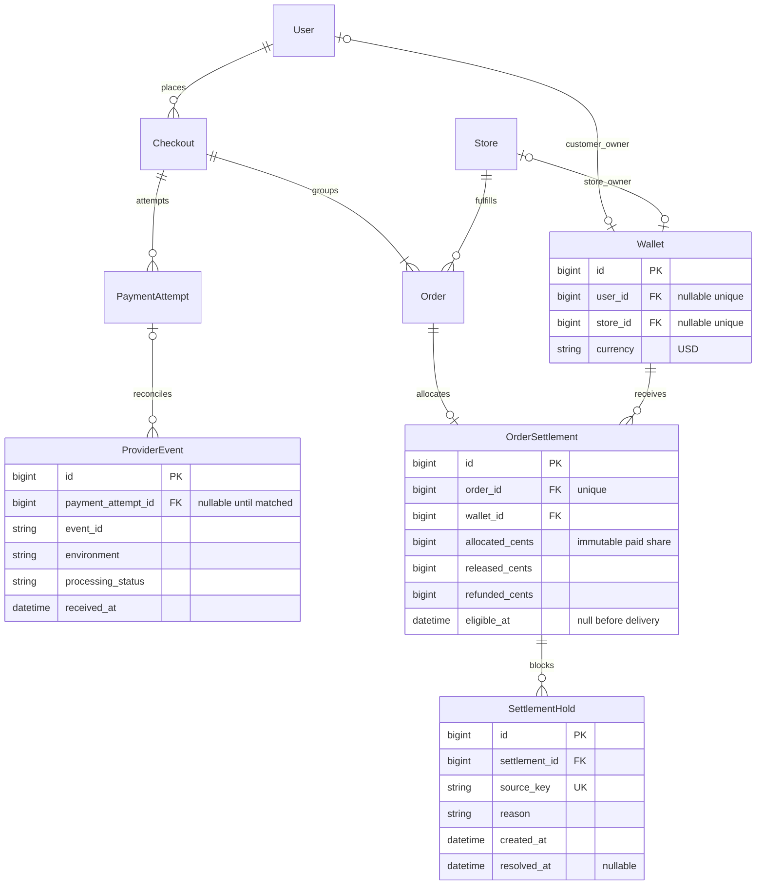
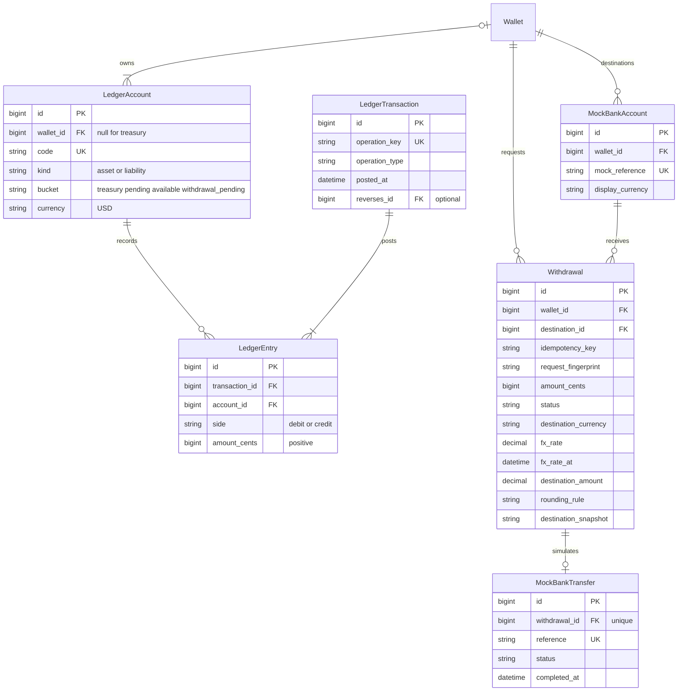

# Proposed demo wallet and settlement ERD

**Status: wallet/ledger and provider-event foundation implemented; settlement and withdrawal design remains proposed.** Read the
[online checkout process](../specific-business-processes/checkout/demo-online-checkout.md)
for business rules and scope. This supplements the existing
[system ERD](e-commerce-entity-relationship-diagram.drawio) without altering it.

## Existing purchase boundary and proposed settlement

User, Store, Checkout, Order, PaymentAttempt and StockReservation already exist.
Wallet and ProviderEvent are now implemented. OrderSettlement and SettlementHold remain proposed additions.
Only relevant relationships/fields are shown; this is not a complete model listing.
`Order.delivered_at` is a proposed addition, distinct from existing `concluded_at`.

- Wallet has exactly one owner: user XOR store, with one USD wallet per owner.
  Financial ownership belongs to the store, not to a particular StoreMember.
  Store country/currency remain pricing metadata; no bank fields are added to Store.
- OrderSettlement exists only for a successfully paid online order. Its wallet
  must belong to that order's store. Proposed zero-fee allocation equals the order
  total, and all allocations sum exactly to the checkout charge.
- Remaining pending amount = allocated − released − refunded, always nonnegative.
  Updates and ledger postings share a transaction. Amounts are counters for
  allocation control; the immutable journal is the financial audit trail.
- A hold blocks the entire remaining settlement initially. Multiple active holds
  are allowed; every hold must resolve before release. `source_key` deduplicates
  the originating operation. Future ReturnCase relationships are deliberately not
  specified yet; they must replace informal source references when returns ship.
- ProviderEvent is unique by provider environment and event ID. Store only necessary
  event data; exclude secrets/card details. Unmatched or failed events remain
  discoverable for retry. Event deduplication does not replace payment-operation
  uniqueness. Checkout can be pending without a settlement or a paid ledger entry.
- A persisted pending checkout is created with its orders atomically. Existing
  OrderItem and StockReservation relationships remain as documented in the
  [backend model contract](../../../backend/docs/checkout/models.md).

## Journal and mock withdrawal boundary

Wallet, LedgerAccount, LedgerTransaction and LedgerEntry are implemented.
MockBankAccount, Withdrawal and MockBankTransfer remain proposed. The implemented
LedgerTransaction additionally stores a request fingerprint; its proposed
`reverses_id` and business foreign keys are deferred. See the
[implemented contract](../../../backend/docs/wallet/README.md).

The diagram omits optional business foreign keys
from LedgerTransaction for readability; posting records should reference the
relevant payment attempt, settlement or withdrawal through protected relationships.

### Posting rules

A wallet owns USD liability accounts: pending, available and withdrawal_pending.
The platform treasury is a separate USD asset account with no wallet owner.
Customer pending accounts may remain unused initially. Enforce one account per
wallet/bucket and one treasury account; allowed kind/owner/bucket combinations
must be validated. Wallet creation starts at zero and never mints funds.

Every posted transaction has at least two positive entries and equal debit/credit
totals in USD cents. Posting must be a single database transaction with a unique
business-operation key and locked affected accounts in consistent order. Row-level
checks alone cannot enforce a balanced multi-row journal; the posting service and
its transaction boundary must do so. No partial journal may become visible.

Use journal-derived balances initially, calculated while holding account locks
that every writer honors. Available/withdrawal/pending liabilities must not go
negative. Treasury must cover the simulated liabilities under the zero-fee model.
If cached balances are later added, update and reconcile them against the journal.
Posted entries cannot be edited or deleted; corrections use linked compensating
transactions, themselves limited to the remaining reversible amount. Financial
references use protected deletion and Django admin is inspection-only.

| Operation | Debit | Credit | Unique operation example |
| --- | --- | --- | --- |
| Verified test payment | Treasury asset, full charge | Each store pending liability, its share | `payment:{attempt}:receipt` |
| Eligible store release | Store pending liability | Same store available liability | `settlement:{id}:release` |
| Reserve withdrawal | Owner available liability | Owner withdrawal_pending liability | `withdrawal:{id}:reserve` |
| Successful mock withdrawal | Owner withdrawal_pending liability | Treasury asset | `withdrawal:{id}:complete` |
| Definitively failed withdrawal | Owner withdrawal_pending liability | Owner available liability | `withdrawal:{id}:restore` |
| Future approved return credit | Store pending liability | Customer available liability | `return-resolution:{id}:credit` |

The initial settlement releases its entire eligible remainder once. A future
partial-release feature needs separate uniquely identified release operations.
Future return amounts must be allocated to the original items and capped by their
unrefunded paid amounts; the current proposal reserves that work for returns.

A withdrawal key is unique per wallet. Reusing it with a different amount or
destination conflicts; save a request fingerprint and immutable destination/FX
terms. States are proposed as `pending`, `processing`, `succeeded`, `failed`.
Unknown adapter outcomes remain processing with funds reserved. A definitive
failure and a success cannot both post; lock/recheck before terminal transition.
The mock adapter's unique withdrawal reference allows recovery after recording a
receipt but before the backend records completion. Destination currency values
are simulation receipt data, not additional currencies in the USD journal.

### Worked example

A customer pays **USD 100** for Store A (60) and Store B (40).

| Event | Treasury asset | A pending / available | B pending / available |
| --- | ---: | ---: | ---: |
| Payment confirmed | 100 | 60 / 0 | 40 / 0 |
| A delivered; seven days pass, no hold | 100 | 0 / 60 | 40 / 0 |
| A mock-withdraws 25 successfully | 75 | 0 / 35 | 40 / 0 |
| B delivered; seven days pass, no hold | 75 | 0 / 35 | 0 / 40 |

The remaining USD 75 backs A's 35 plus B's 40. Local-currency display changes
none of these values. A future USD 10 return credit before B's release instead
moves 10 from B pending to customer available; treasury stays unchanged.

## Current implementation gaps

The wallet and USD journal foundation is implemented with atomic posting and
read-only admin. Stripe test payments now finalize orders and fund pending store accounts.
Settlement, delivery timestamps and mock withdrawals remain future work. Current COD
remains independent and must not create simulated treasury receipts on placement.
Current paid/fulfillment status fields alone do not guarantee any posting or sold
count update. Preview and COD now honor unresolved holds past their deadlines, as documented
in the [online API](../../../backend/docs/checkout/stripe-api.md).

The existing draw.io ERD and general-process draft remain unchanged. This proposal
is a supplementary design; only the foundation explicitly identified above is implemented.

## Validation

Both ERD diagrams and the four process swimlanes parsed and rendered with Mermaid
12.0.0 in Chromium on 2026-10-09. Rendered labels and relationships were visually
inspected. Relative links were checked. Markdown-host support for `swimlane-beta`
has not been verified; local rendering does not establish GitHub compatibility.

PaymentAttempt now links one protected ledger receipt and stores immutable
session-creation parameters. The ProviderEvent diagram shows its core fields; the
implementation additionally stores session routing identifiers, retry/completion
timestamps and safe error codes. No settlement allocation rows are created yet.
