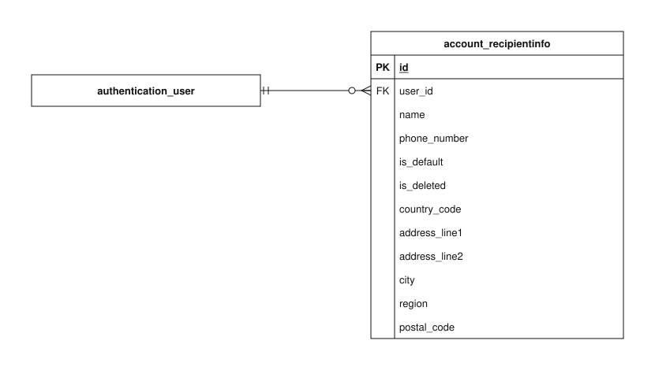

# Account data model

This guide explains the implemented `account` app schema in the checked-in Django models and migrations. It covers every concrete column of its 1 tables.

Open the SVG in Draw.io to edit its single `account` page. PK means primary key; FK means foreign key. A name-only rectangle references an entity owned by another app. A circle means zero, a bar means one, and a branching foot means many. The guide describes source code, not confirmation that migrations have been applied to a deployed database.

## Reading the fields

Field types and defaults below are Django definitions. Unless marked nullable, a column cannot store SQL null. `blank=True` permits empty input during field validation; it does not imply SQL null. ORM defaults are not promises of database-side SQL defaults. Constraints described as application validation can be bypassed by bulk/queryset writes or raw SQL. Foreign-key columns normally use the model attribute plus `_id`.

## Models

### RecipientInfo

A saved delivery contact and address owned by an account. A customer can keep several recipients, independently of their personal UserAddress.

**Table:** `account_recipientinfo`. **Model:** `account.RecipientInfo`.

A partial unique constraint allows at most one default recipient per user. The deleted_recipient_not_default check forbids a deleted row from remaining default. These constraints do not require every user to have a recipient or guarantee that every active recipient set has a default; the account service maintains that behavior under the customer lock.

| Field / column     | Meaning                                                                                              | Constraints and behavior                                                              |
| ------------------ | ---------------------------------------------------------------------------------------------------- | ------------------------------------------------------------------------------------- |
| `id`               | Internal identifier for this stored record.                                                          | BigAutoField; generated primary key.                                                  |
| `user` → `user_id` | Account that owns or participates in this record.                                                    | ForeignKey; not null; FK to `authentication_user.id`; CASCADE on referenced deletion. |
| `name`             | Person who should receive the delivery.                                                              | CharField, max 100 characters; not null.                                              |
| `phone_number`     | Contact phone number for the account or delivery recipient.                                          | CharField, max 20 characters; not null.                                               |
| `is_default`       | Whether this is the account’s preferred recipient for future purchases.                              | BooleanField; not null; ORM default false.                                            |
| `is_deleted`       | Soft-deletion flag excluding this saved recipient from future selection while retaining order links. | BooleanField; not null; ORM default false.                                            |
| `country_code`     | Two-letter country code for this address or store.                                                   | CharField, max 2 characters; not null.                                                |
| `address_line1`    | Primary street/building address used to locate the recipient or owner.                               | CharField, max 150 characters; not null.                                              |
| `address_line2`    | Additional delivery or location detail, such as a unit or floor.                                     | CharField, max 150 characters; not null; blank allowed by field validation.           |
| `city`             | City or locality of the address.                                                                     | CharField, max 100 characters; not null.                                              |
| `region`           | State, province, or other regional address component.                                                | CharField, max 100 characters; not null; blank allowed by field validation.           |
| `postal_code`      | Postal routing code for the address.                                                                 | CharField, max 20 characters; not null; blank allowed by field validation.            |

## Relationships and external references

Each row states how many referenced records one local row can use, and how many local records one referenced record may have. Reverse optionality is based on schema enforcement, not on a service normally creating a child.

| Local column                    | Referenced entity     | Per local row / per referenced row | Deletion of referenced record |
| ------------------------------- | --------------------- | ---------------------------------- | ----------------------------- |
| `account_recipientinfo.user_id` | `authentication_user` | exactly one / zero or many         | CASCADE                       |

External entities are name-only references in this diagram:

- `authentication_user`: full definition in [authentication](authentication.md).

## Persistence and lifecycle

Recipient creation, updates, soft deletion, profile updates, and placement coordinate through the customer row lock. The first active recipient is made default. Choosing a new default clears the previous one in the same transaction; the current default cannot simply be cleared while editing it.

Deleting a default recipient while other active recipients exist requires selecting a valid replacement. The service sets is_default=False and is_deleted=True, retaining the record for protected historical orders. Repeated deletion is safe. New placement excludes deleted recipients and validates complete contact/address details before copying them into the order snapshot. Editing a saved recipient never changes those snapshots.

A personal UserAddress belongs to authentication and is saved separately from recipients. API ownership comes from the authenticated account, not a caller-supplied user_id.

## Implementation and related guides

- [Model definitions](../../../../backend/apps/account/models.py).
- [Schema migrations](../../../../backend/apps/account/migrations).
- [apps/account/services/account.py](../../../../backend/apps/account/services/account.py).
- [apps/account/serializers/account.py](../../../../backend/apps/account/serializers/account.py).
- [apps/checkout/services/snapshots.py](../../../../backend/apps/checkout/services/snapshots.py).
- [Password changes](../../specific-business-processes/account/change-password.md).
- [Cash on delivery](../../specific-business-processes/checkout/cod-checkout.md).
- [Data-model and business-process index](../../README.md).
