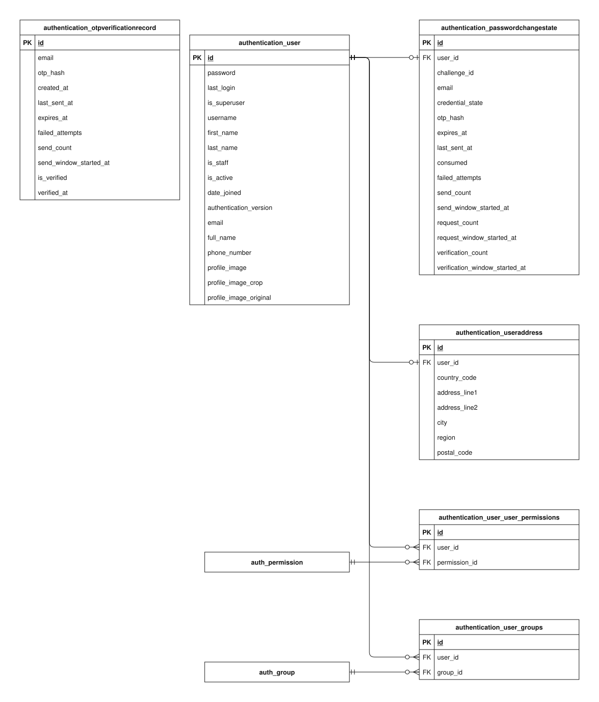

# Authentication data model

This guide explains the implemented `authentication` app schema in the checked-in Django models and migrations. It covers every concrete column of its 6 tables (including the two automatically generated user-permission join tables).

Open the SVG in Draw.io to edit its single `authentication` page. PK means primary key; FK means foreign key. A name-only rectangle references an entity owned by another app. A circle means zero, a bar means one, and a branching foot means many. The guide describes source code, not confirmation that migrations have been applied to a deployed database.

## Reading the fields

Field types and defaults below are Django definitions. Unless marked nullable, a column cannot store SQL null. `blank=True` permits empty input during field validation; it does not imply SQL null. ORM defaults are not promises of database-side SQL defaults. Constraints described as application validation can be bypassed by bulk/queryset writes or raw SQL. Foreign-key columns normally use the model attribute plus `_id`.

## Models

### OTPVerificationRecord

Registration email verification state keyed by email before an account exists. It does not require a User row.

**Table:** `authentication_otpverificationrecord`. **Model:** `authentication.OTPVerificationRecord`.

Email is unique. Issuance normalizes it to lowercase, locks the row, hashes a new code, enforces cooldown/send budgets, and resets verification and failed-attempt state on an accepted resend. The unique email constraint arbitrates concurrent initial creation. Email delivery is separate from saved issuance.

| Field / column           | Meaning                                                                          | Constraints and behavior                                    |
| ------------------------ | -------------------------------------------------------------------------------- | ----------------------------------------------------------- |
| `id`                     | Internal identifier for this stored record.                                      | BigAutoField; generated primary key.                        |
| `email`                  | Normalized email whose registration ownership is being verified.                 | EmailField, max 254 characters; not null; unique.           |
| `otp_hash`               | Encoded one-time-code hash used for verification; never the plaintext code.      | CharField, max 255 characters; not null.                    |
| `created_at`             | When this record was first inserted.                                             | DateTimeField; not null; set on insertion.                  |
| `last_sent_at`           | When the latest code was prepared, used to enforce resend cooldown.              | DateTimeField; not null.                                    |
| `expires_at`             | Deadline for accepting the latest registration code.                             | DateTimeField; not null.                                    |
| `failed_attempts`        | Number of incorrect code submissions counted for the current verification state. | PositiveSmallIntegerField; not null; ORM default 0.         |
| `send_count`             | Number of code sends charged to the current send window.                         | PositiveSmallIntegerField; not null; ORM default 1.         |
| `send_window_started_at` | Beginning of the current code-send budget window.                                | DateTimeField; not null.                                    |
| `is_verified`            | Whether the stored registration code has been verified.                          | BooleanField; not null; ORM default false.                  |
| `verified_at`            | When registration verification last succeeded.                                   | DateTimeField; nullable; blank allowed by field validation. |

### User

The customer or staff account. Email is the login identifier; inherited Django fields support passwords, permissions, and account status.

**Table:** `authentication_user`. **Model:** `authentication.User`.

Email, username, and phone number are individually unique. Registration applies stricter username/contact/password validation than the raw model field sizes. The password column stores an encoded Django hash, never plaintext. authentication_version is checked for protected requests and refresh; successful password changes increment it atomically with the password update.

| Field / column           | Meaning                                                                      | Constraints and behavior                                                                          |
| ------------------------ | ---------------------------------------------------------------------------- | ------------------------------------------------------------------------------------------------- |
| `id`                     | Internal identifier for this stored record.                                  | BigAutoField; generated primary key.                                                              |
| `password`               | Encoded account password used by Django authentication.                      | CharField, max 128 characters; not null.                                                          |
| `last_login`             | Most recently recorded successful login time.                                | DateTimeField; nullable; blank allowed by field validation.                                       |
| `is_superuser`           | Whether Django permission checks grant unrestricted model permissions.       | BooleanField; not null; ORM default false.                                                        |
| `username`               | Unique inherited account username, separate from the email login identifier. | CharField, max 150 characters; not null; unique; Django username validator.                       |
| `first_name`             | Inherited given-name field; the project also stores full_name.               | CharField, max 150 characters; not null; blank allowed by field validation.                       |
| `last_name`              | Inherited family-name field; the project also stores full_name.              | CharField, max 150 characters; not null; blank allowed by field validation.                       |
| `is_staff`               | Whether the account may access Django staff/admin login.                     | BooleanField; not null; ORM default false.                                                        |
| `is_active`              | Whether authentication should treat this account as enabled.                 | BooleanField; not null; ORM default true.                                                         |
| `date_joined`            | When the account was created.                                                | DateTimeField; not null; ORM default current time.                                                |
| `authentication_version` | Session-revocation counter embedded in and checked against issued tokens.    | PositiveIntegerField; not null; ORM default 0.                                                    |
| `email`                  | Unique email address used as the login identifier.                           | EmailField, max 254 characters; not null; unique.                                                 |
| `full_name`              | Customer-facing full display name.                                           | CharField, max 100 characters; not null.                                                          |
| `phone_number`           | Contact phone number for the account or delivery recipient.                  | CharField, max 20 characters; not null; unique.                                                   |
| `profile_image`          | Stored file name for the displayed profile image.                            | ImageField; not null; blank allowed by field validation.                                          |
| `profile_image_crop`     | Saved crop metadata for displaying the profile image.                        | JSONField; not null; blank allowed by field validation; ORM default {} (new object per instance). |
| `profile_image_original` | Stored file name for the original profile upload retained for recropping.    | ImageField; not null; blank allowed by field validation.                                          |

### UserAddress

The account holder’s personal address. It is independent of saved delivery recipients and purchase snapshots.

**Table:** `authentication_useraddress`. **Model:** `authentication.UserAddress`.

A user can have zero or one personal address. Registration creates it with the account; profile updates use update_or_create under the customer lock. Address edits do not rewrite RecipientInfo or existing order snapshots.

| Field / column     | Meaning                                                                | Constraints and behavior                                                                         |
| ------------------ | ---------------------------------------------------------------------- | ------------------------------------------------------------------------------------------------ |
| `id`               | Internal identifier for this stored record.                            | BigAutoField; generated primary key.                                                             |
| `user` → `user_id` | Account that owns or participates in this record.                      | OneToOneField; not null; FK to `authentication_user.id`; unique; CASCADE on referenced deletion. |
| `country_code`     | Two-letter country code for this address or store.                     | CharField, max 2 characters; not null.                                                           |
| `address_line1`    | Primary street/building address used to locate the recipient or owner. | CharField, max 150 characters; not null.                                                         |
| `address_line2`    | Additional delivery or location detail, such as a unit or floor.       | CharField, max 150 characters; not null; blank allowed by field validation.                      |
| `city`             | City or locality of the address.                                       | CharField, max 100 characters; not null.                                                         |
| `region`           | State, province, or other regional address component.                  | CharField, max 100 characters; not null; blank allowed by field validation.                      |
| `postal_code`      | Postal routing code for the address.                                   | CharField, max 20 characters; not null; blank allowed by field validation.                       |

### PasswordChangeState

One persistent challenge slot per account, combining the current password-change challenge with account-level request, send, and verification budgets.

**Table:** `authentication_passwordchangestate`. **Model:** `authentication.PasswordChangeState`.

Both user_id and a non-null challenge_id are unique. Replacing a challenge reuses the same state row and primary key. A new challenge rotates the UUID and resets failed_attempts, while account send/request/verification budgets survive challenge replacement. Resending preserves the challenge UUID and failed-attempt count. The state row is created lazily; its window timestamps are supplied by the service.

| Field / column                   | Meaning                                                                                        | Constraints and behavior                                                                         |
| -------------------------------- | ---------------------------------------------------------------------------------------------- | ------------------------------------------------------------------------------------------------ |
| `id`                             | Internal identifier for this stored record.                                                    | BigAutoField; generated primary key.                                                             |
| `user` → `user_id`               | Account that owns or participates in this record.                                              | OneToOneField; not null; FK to `authentication_user.id`; unique; CASCADE on referenced deletion. |
| `challenge_id`                   | Public identifier of the current challenge; rotates on a new request.                          | UUIDField; nullable; unique.                                                                     |
| `email`                          | Destination email snapshot used to reject challenges after an account email change.            | EmailField, max 254 characters; not null; blank allowed by field validation.                     |
| `credential_state`               | Keyed digest binding the challenge to the current encoded account password.                    | CharField, max 64 characters; not null; blank allowed by field validation.                       |
| `otp_hash`                       | Encoded one-time-code hash used for verification; never the plaintext code.                    | CharField, max 255 characters; not null; blank allowed by field validation.                      |
| `expires_at`                     | Deadline for confirming the current password-change code.                                      | DateTimeField; nullable.                                                                         |
| `last_sent_at`                   | When the latest code was prepared, used to enforce resend cooldown.                            | DateTimeField; nullable.                                                                         |
| `consumed`                       | Whether the challenge has been used or invalidated; expiry is checked separately.              | BooleanField; not null; ORM default true.                                                        |
| `failed_attempts`                | Number of incorrect code submissions counted for the current verification state.               | PositiveSmallIntegerField; not null; ORM default 0.                                              |
| `send_count`                     | Number of code sends charged to the current send window.                                       | PositiveIntegerField; not null; ORM default 0.                                                   |
| `send_window_started_at`         | Beginning of the current code-send budget window.                                              | DateTimeField; not null.                                                                         |
| `request_count`                  | Account-level budget charged for initial requests and resends, including rejected validations. | PositiveIntegerField; not null; ORM default 0.                                                   |
| `request_window_started_at`      | Beginning of the current request budget window.                                                | DateTimeField; not null.                                                                         |
| `verification_count`             | Account-level budget charged before confirmation eligibility and code/password validation.     | PositiveIntegerField; not null; ORM default 0.                                                   |
| `verification_window_started_at` | Beginning of the current confirmation budget window.                                           | DateTimeField; not null.                                                                         |

### User.groups through table

Django-generated membership links between accounts and Django authorization groups.

**Table:** `authentication_user_groups`. **Model:** `User.groups (automatic through table)`.

The user/group pair is unique. Both foreign keys cascade on deletion. Group and permission definitions belong to Django’s built-in auth app and are outside these seven project-app guides.

| Field / column       | Meaning                                             | Constraints and behavior                                                              |
| -------------------- | --------------------------------------------------- | ------------------------------------------------------------------------------------- |
| `id`                 | Internal identifier for this stored record.         | BigAutoField; generated primary key.                                                  |
| `user` → `user_id`   | Account that owns or participates in this record.   | ForeignKey; not null; FK to `authentication_user.id`; CASCADE on referenced deletion. |
| `group` → `group_id` | Django authorization group assigned to the account. | ForeignKey; not null; FK to `auth_group.id`; CASCADE on referenced deletion.          |

### User.user_permissions through table

Django-generated links granting individual Django permissions directly to an account.

**Table:** `authentication_user_user_permissions`. **Model:** `User.user_permissions (automatic through table)`.

The user/permission pair is unique. Both foreign keys cascade on deletion. These links grant direct permissions; group-derived permissions use the separate groups association.

| Field / column                 | Meaning                                            | Constraints and behavior                                                              |
| ------------------------------ | -------------------------------------------------- | ------------------------------------------------------------------------------------- |
| `id`                           | Internal identifier for this stored record.        | BigAutoField; generated primary key.                                                  |
| `user` → `user_id`             | Account that owns or participates in this record.  | ForeignKey; not null; FK to `authentication_user.id`; CASCADE on referenced deletion. |
| `permission` → `permission_id` | Django permission granted directly to the account. | ForeignKey; not null; FK to `auth_permission.id`; CASCADE on referenced deletion.     |

## Relationships and external references

Each row states how many referenced records one local row can use, and how many local records one referenced record may have. Reverse optionality is based on schema enforcement, not on a service normally creating a child.

| Local column                                         | Referenced entity     | Per local row / per referenced row | Deletion of referenced record |
| ---------------------------------------------------- | --------------------- | ---------------------------------- | ----------------------------- |
| `authentication_useraddress.user_id`                 | `authentication_user` | exactly one / zero or one          | CASCADE                       |
| `authentication_passwordchangestate.user_id`         | `authentication_user` | exactly one / zero or one          | CASCADE                       |
| `authentication_user_groups.user_id`                 | `authentication_user` | exactly one / zero or many         | CASCADE                       |
| `authentication_user_groups.group_id`                | `auth_group`          | exactly one / zero or many         | CASCADE                       |
| `authentication_user_user_permissions.user_id`       | `authentication_user` | exactly one / zero or many         | CASCADE                       |
| `authentication_user_user_permissions.permission_id` | `auth_permission`     | exactly one / zero or many         | CASCADE                       |

External entities are name-only references in this diagram:

- `auth_group`: Django built-in authorization data; its owned schema is outside these project-app guides.
- `auth_permission`: Django built-in authorization data; its owned schema is outside these project-app guides.

## Persistence and lifecycle

Registration creates User, UserAddress, and the initial default RecipientInfo atomically after verification of the registration token. Later profile/address edits and delivery-recipient edits are independent. Profile image handling retains an original upload for recropping; image replacement/deletion cleanup runs after commit.

Registration code issuance persists a hashed code before delivery. An issued or queued code does not prove email delivery. Password-change verification uses a separate state model and separate budgets.

The password-change service locks the owning user and commits state even for expected validation/rate-limit errors. Request and verification budgets are charged before their respective validation steps; send budget is charged after validation and cooldown checks. A budget already at its limit rejects without incrementing it. Window expiry resets the corresponding budget. Limit values, code lifetime, and cooldown come from settings rather than columns.

Password-change email publication runs after commit. Delivery failure retains the prepared challenge, cooldown, and used budgets. Confirmation at or after expires_at is rejected. Incorrect codes increment failed_attempts and consume the challenge at the configured limit. Email/credential mismatch also consumes it. A successful confirmation atomically updates the encoded password, increments authentication_version, consumes the challenge, and replaces otp_hash with an unusable hash. No proposed new password is persisted in the challenge row.

## Implementation and related guides

- [Model definitions](../../../../backend/apps/authentication/models.py).
- [Schema migrations](../../../../backend/apps/authentication/migrations).
- [apps/authentication/serializers.py](../../../../backend/apps/authentication/serializers.py).
- [apps/authentication/services/otp_service.py](../../../../backend/apps/authentication/services/otp_service.py).
- [apps/authentication/signals.py](../../../../backend/apps/authentication/signals.py).
- [apps/account/services/password.py](../../../../backend/apps/account/services/password.py).
- [apps/account/services/photo.py](../../../../backend/apps/account/services/photo.py).
- [Registration email](../../specific-business-processes/authentication/registration-otp-email.md).
- [Password changes](../../specific-business-processes/account/change-password.md).
- [Data-model and business-process index](../../README.md).
