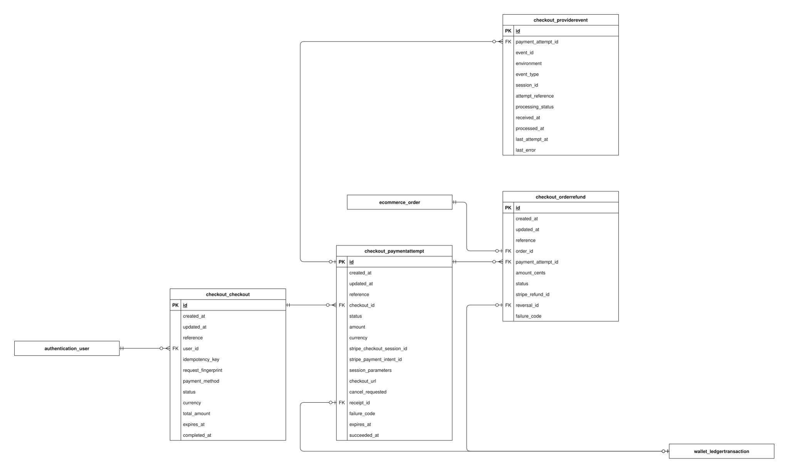

# Checkout data model

This guide explains the implemented `checkout` app schema in the checked-in Django models and migrations. It covers every concrete column of its 4 tables.

Open the SVG in Draw.io to edit its single `checkout` page. PK means primary key; FK means foreign key. A name-only rectangle references an entity owned by another app. A circle means zero, a bar means one, and a branching foot means many. The guide describes source code, not confirmation that migrations have been applied to a deployed database.

## Reading the fields

Field types and defaults below are Django definitions. Unless marked nullable, a column cannot store SQL null. `blank=True` permits empty input during field validation; it does not imply SQL null. ORM defaults are not promises of database-side SQL defaults. Constraints described as application validation can be bypassed by bulk/queryset writes or raw SQL. Foreign-key columns normally use the model attribute plus `_id`.

## Models

### Checkout

The customer’s complete purchase request across stores, including accepted currency/total, payment method, and idempotent request identity.

**Table:** `checkout_checkout`. **Model:** `checkout.Checkout`.

The user/idempotency_key pair is unique and total_amount cannot be negative. full_clean() validates ordinary saves; once orders or attempts exist, the purchaser, payment method, amount/currency, key, and request fingerprint cannot be changed through those saves. The service checks a matching persisted fingerprint before accepting a replay.

| Field / column        | Meaning                                                                                             | Constraints and behavior                                                                                                                                         |
| --------------------- | --------------------------------------------------------------------------------------------------- | ---------------------------------------------------------------------------------------------------------------------------------------------------------------- |
| `id`                  | Internal identifier for this stored record.                                                         | BigAutoField; generated primary key.                                                                                                                             |
| `created_at`          | When this record was first inserted.                                                                | DateTimeField; not null; set on insertion.                                                                                                                       |
| `updated_at`          | When this record was last saved through timestamp-aware ORM writes.                                 | DateTimeField; not null; set on ORM save when included in the write.                                                                                             |
| `reference`           | Public UUID identifying this purchase, payment, or refund independently of its integer primary key. | UUIDField; not null; unique; ORM default new random UUID; not form-editable.                                                                                     |
| `user` → `user_id`    | Account that owns or participates in this record.                                                   | ForeignKey; not null; FK to `authentication_user.id`; PROTECT on referenced deletion.                                                                            |
| `idempotency_key`     | Client request identifier, unique together with the purchasing user.                                | UUIDField; not null.                                                                                                                                             |
| `request_fingerprint` | SHA-256 digest of normalized accepted placement terms, used to detect conflicting replays.          | CharField, max 64 characters; not null; blank allowed by field validation; ORM default ""; not form-editable; 64 lowercase hexadecimal characters when nonblank. |
| `payment_method`      | Cash on delivery or Stripe test payment.                                                            | CharField, max 10 characters; not null; ORM default "cod"; choices: `cod`, `stripe`.                                                                             |
| `status`              | Overall checkout lifecycle; completed means placement/payment completion, not delivery.             | CharField, max 10 characters; not null; ORM default "pending"; choices: `pending`, `completed`, `cancelled`, `expired`.                                          |
| `currency`            | Accepted purchase currency for totals and converted line prices.                                    | CharField, max 3 characters; not null; three uppercase letters.                                                                                                  |
| `total_amount`        | Accepted total across all store orders.                                                             | Decimal(18, 3); not null.                                                                                                                                        |
| `expires_at`          | Saved deadline for resolving a pending online purchase.                                             | DateTimeField; nullable; blank allowed by field validation.                                                                                                      |
| `completed_at`        | When COD placement or confirmed online payment completed.                                           | DateTimeField; nullable; blank allowed by field validation.                                                                                                      |

### PaymentAttempt

The durable Stripe test payment attempt and its provider session, recovery data, and optional ledger receipt.

**Table:** `checkout_paymentattempt`. **Model:** `checkout.PaymentAttempt`.

Amount must be positive. A conditional unique constraint allows at most one pending attempt per checkout; historical attempts remain one-to-many in the schema. The current service recovers the original attempt rather than replacing closed sessions. full_clean() requires a Stripe checkout with matching amount/currency and prevents changing assigned identities/provider/receipt references.

| Field / column               | Meaning                                                                                             | Constraints and behavior                                                                                                                 |
| ---------------------------- | --------------------------------------------------------------------------------------------------- | ---------------------------------------------------------------------------------------------------------------------------------------- |
| `id`                         | Internal identifier for this stored record.                                                         | BigAutoField; generated primary key.                                                                                                     |
| `created_at`                 | When this record was first inserted.                                                                | DateTimeField; not null; set on insertion.                                                                                               |
| `updated_at`                 | When this record was last saved through timestamp-aware ORM writes.                                 | DateTimeField; not null; set on ORM save when included in the write.                                                                     |
| `reference`                  | Public UUID identifying this purchase, payment, or refund independently of its integer primary key. | UUIDField; not null; unique; ORM default new random UUID; not form-editable.                                                             |
| `checkout` → `checkout_id`   | Complete customer purchase grouping this record.                                                    | ForeignKey; not null; FK to `checkout_checkout.id`; PROTECT on referenced deletion.                                                      |
| `status`                     | Current lifecycle state of the saved provider attempt.                                              | CharField, max 10 characters; not null; ORM default "pending"; choices: `pending`, `succeeded`, `failed`, `cancelled`, `expired`.        |
| `amount`                     | Agreed provider charge amount matching the checkout total.                                          | Decimal(18, 3); not null.                                                                                                                |
| `currency`                   | Agreed provider charge currency matching the checkout.                                              | CharField, max 3 characters; not null; three uppercase letters.                                                                          |
| `stripe_checkout_session_id` | Provider Checkout Session identifier once assigned.                                                 | CharField, max 255 characters; nullable; unique; blank allowed by field validation.                                                      |
| `stripe_payment_intent_id`   | Provider PaymentIntent identifier once assigned.                                                    | CharField, max 255 characters; nullable; unique; blank allowed by field validation.                                                      |
| `session_parameters`         | Saved provider session-creation parameters reused for safe recovery.                                | JSONField; not null; blank allowed by field validation; ORM default {} (new object per instance); not form-editable.                     |
| `checkout_url`               | Validated hosted Stripe payment URL while usable.                                                   | URLField, max 2048 characters; not null; blank allowed by field validation.                                                              |
| `cancel_requested`           | Durable customer intent to cancel an unresolved provider session.                                   | BooleanField; not null; ORM default false.                                                                                               |
| `receipt` → `receipt_id`     | Immutable ledger receipt posted after verified payment.                                             | OneToOneField; nullable; FK to `wallet_ledgertransaction.id`; unique; PROTECT on referenced deletion; blank allowed by field validation. |
| `failure_code`               | Safe application/provider error code retained for recovery without storing raw exception details.   | CharField, max 100 characters; not null; blank allowed by field validation.                                                              |
| `expires_at`                 | Provider/payment deadline retained for reconciliation.                                              | DateTimeField; nullable; blank allowed by field validation.                                                                              |
| `succeeded_at`               | When verified provider success was recorded.                                                        | DateTimeField; nullable; blank allowed by field validation.                                                                              |

### ProviderEvent

A minimal durable Stripe test webhook inbox, retaining routing identifiers and processing state rather than the full provider payload.

**Table:** `checkout_providerevent`. **Model:** `checkout.ProviderEvent`.

The environment/event_id pair is unique and environment must be test. A processing_status/received_at index supports recovery scans. payment_attempt may be unresolved on receipt; session_id and attempt_reference are routing strings, not additional database foreign keys.

| Field / column                           | Meaning                                                              | Constraints and behavior                                                                                                     |
| ---------------------------------------- | -------------------------------------------------------------------- | ---------------------------------------------------------------------------------------------------------------------------- |
| `id`                                     | Internal identifier for this stored record.                          | BigAutoField; generated primary key.                                                                                         |
| `payment_attempt` → `payment_attempt_id` | Resolved local payment attempt, if identified during processing.     | ForeignKey; nullable; FK to `checkout_paymentattempt.id`; PROTECT on referenced deletion; blank allowed by field validation. |
| `event_id`                               | Stripe webhook event identifier, deduplicated within environment.    | CharField, max 255 characters; not null.                                                                                     |
| `environment`                            | Provider environment; this inbox only accepts test events.           | CharField, max 10 characters; not null; ORM default "test"; not form-editable.                                               |
| `event_type`                             | Stripe event kind used to route processing.                          | CharField, max 100 characters; not null.                                                                                     |
| `session_id`                             | Checkout Session identifier extracted for routing.                   | CharField, max 255 characters; not null.                                                                                     |
| `attempt_reference`                      | Public attempt UUID extracted as a string for routing when present.  | CharField, max 36 characters; not null; blank allowed by field validation.                                                   |
| `processing_status`                      | Whether inbox processing is pending, processed, or failed.           | CharField, max 10 characters; not null; ORM default "pending"; choices: `pending`, `processed`, `failed`.                    |
| `received_at`                            | When this event was first persisted.                                 | DateTimeField; not null; set on insertion.                                                                                   |
| `processed_at`                           | When processing completed successfully.                              | DateTimeField; nullable; blank allowed by field validation.                                                                  |
| `last_attempt_at`                        | Most recent processing/recovery attempt time.                        | DateTimeField; nullable; blank allowed by field validation.                                                                  |
| `last_error`                             | Safe processing error code, not a raw provider payload or exception. | CharField, max 100 characters; not null; blank allowed by field validation.                                                  |

### OrderRefund

One durable full-store-order refund. It represents only that store’s share of a potentially multi-store Stripe charge.

**Table:** `checkout_orderrefund`. **Model:** `checkout.OrderRefund`.

order_id is unique and amount_cents must be positive. The order and payment attempt must refer to the same checkout. Ordinary saves cannot change refund identity/amount or reassign a known provider refund/reversal. stripe_refund_id and reversal_id are individually unique when present. Provider status uses canceled with one l; checkout cancellation uses cancelled.

| Field / column                           | Meaning                                                                                             | Constraints and behavior                                                                                                                 |
| ---------------------------------------- | --------------------------------------------------------------------------------------------------- | ---------------------------------------------------------------------------------------------------------------------------------------- |
| `id`                                     | Internal identifier for this stored record.                                                         | BigAutoField; generated primary key.                                                                                                     |
| `created_at`                             | When this record was first inserted.                                                                | DateTimeField; not null; set on insertion.                                                                                               |
| `updated_at`                             | When this record was last saved through timestamp-aware ORM writes.                                 | DateTimeField; not null; set on ORM save when included in the write.                                                                     |
| `reference`                              | Public UUID identifying this purchase, payment, or refund independently of its integer primary key. | UUIDField; not null; unique; ORM default new random UUID; not form-editable.                                                             |
| `order` → `order_id`                     | Store purchase to which this record belongs.                                                        | OneToOneField; not null; FK to `ecommerce_order.id`; unique; PROTECT on referenced deletion.                                             |
| `payment_attempt` → `payment_attempt_id` | Saved Stripe test attempt associated with this record.                                              | ForeignKey; not null; FK to `checkout_paymentattempt.id`; PROTECT on referenced deletion.                                                |
| `amount_cents`                           | Fixed positive USD cents to refund for the complete store order.                                    | PositiveBigIntegerField; not null.                                                                                                       |
| `status`                                 | Provider refund lifecycle, including requires_action and canceled.                                  | CharField, max 20 characters; not null; ORM default "pending"; choices: `pending`, `requires_action`, `succeeded`, `failed`, `canceled`. |
| `stripe_refund_id`                       | Unique Stripe refund identifier once assigned.                                                      | CharField, max 255 characters; nullable; unique; blank allowed by field validation.                                                      |
| `reversal` → `reversal_id`               | Compensating ledger transaction posted after the refund is confirmed.                               | OneToOneField; nullable; FK to `wallet_ledgertransaction.id`; unique; PROTECT on referenced deletion; blank allowed by field validation. |
| `failure_code`                           | Safe application/provider error code retained for recovery without storing raw exception details.   | CharField, max 100 characters; not null; blank allowed by field validation.                                                              |

## Relationships and external references

Each row states how many referenced records one local row can use, and how many local records one referenced record may have. Reverse optionality is based on schema enforcement, not on a service normally creating a child.

| Local column                                | Referenced entity          | Per local row / per referenced row | Deletion of referenced record |
| ------------------------------------------- | -------------------------- | ---------------------------------- | ----------------------------- |
| `checkout_checkout.user_id`                 | `authentication_user`      | exactly one / zero or many         | PROTECT                       |
| `checkout_paymentattempt.checkout_id`       | `checkout_checkout`        | exactly one / zero or many         | PROTECT                       |
| `checkout_paymentattempt.receipt_id`        | `wallet_ledgertransaction` | zero or one / zero or one          | PROTECT                       |
| `checkout_providerevent.payment_attempt_id` | `checkout_paymentattempt`  | zero or one / zero or many         | PROTECT                       |
| `checkout_orderrefund.order_id`             | `ecommerce_order`          | exactly one / zero or one          | PROTECT                       |
| `checkout_orderrefund.payment_attempt_id`   | `checkout_paymentattempt`  | exactly one / zero or many         | PROTECT                       |
| `checkout_orderrefund.reversal_id`          | `wallet_ledgertransaction` | zero or one / zero or one          | PROTECT                       |

External entities are name-only references in this diagram:

- `authentication_user`: full definition in [authentication](authentication.md).
- `ecommerce_order`: full definition in [ecommerce](ecommerce.md).
- `wallet_ledgertransaction`: full definition in [wallet](wallet.md).

## Persistence and lifecycle

Preview returns signed accepted terms without creating purchases or holds. Placement locks the customer, recipient, product/store rows, and selected cart lines, then rechecks the terms and available inventory. The user/key pair and normalized request fingerprint distinguish an identical replay from a conflicting purchase. Legacy empty fingerprints are not accepted as matching COD replays.

COD commits a completed checkout, unpaid store orders, and stock deductions atomically. Stripe test placement instead commits pending purchases, one payment attempt, and stock holds before contacting the provider. Browser returns, webhook receipt, and local expiry timestamps are not payment proof. Provider calls occur outside database locks; verified provider facts drive atomic order/stock/ledger finalization and safe hold release. Payment completion does not mean delivery.

Stripe events are deduplicated by test environment/event ID and retain minimal identifiers. PaymentAttempt receipt links protect immutable ledger transactions. Recovery retries use the saved attempt and provider session; uncertain remote outcomes retain durable state rather than triggering another charge.

Cancellation creates one durable full-store-order refund and preserves the original charge receipt. Only a verified successful provider refund posts the compensating journal entry. Retry uses the same refund; after the service’s 23-hour safety window an unknown provider request is searched for rather than recreated, with unresolved cases flagged for manual review. Refund recovery has a management command but is not scheduled by the current Beat configuration. Stripe live payments, settlement release, and withdrawals remain outside the implemented workflow.

## Implementation and related guides

- [Model definitions](../../../../backend/apps/checkout/models.py).
- [Schema migrations](../../../../backend/apps/checkout/migrations).
- [apps/checkout/services/placement.py](../../../../backend/apps/checkout/services/placement.py).
- [apps/checkout/services/online.py](../../../../backend/apps/checkout/services/online.py).
- [apps/checkout/services/events.py](../../../../backend/apps/checkout/services/events.py).
- [apps/checkout/services/refunds.py](../../../../backend/apps/checkout/services/refunds.py).
- [apps/checkout/services/snapshots.py](../../../../backend/apps/checkout/services/snapshots.py).
- [Cash on delivery](../../specific-business-processes/checkout/cod-checkout.md).
- [Stripe test checkout](../../specific-business-processes/checkout/demo-online-checkout.md).
- [Data-model and business-process index](../../README.md).
