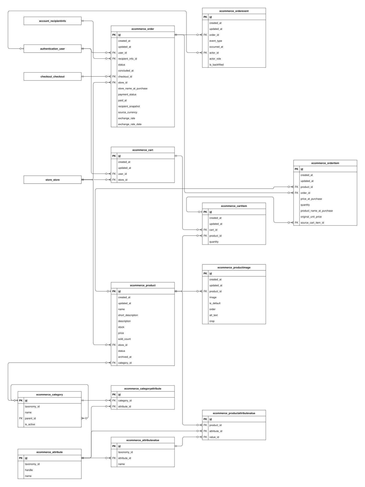

# Ecommerce data model

This guide explains the implemented `ecommerce` app schema in the checked-in Django models and migrations. It covers every concrete column of its 12 tables.

Open the SVG in Draw.io to edit its single `ecommerce` page. PK means primary key; FK means foreign key. A name-only rectangle references an entity owned by another app. A circle means zero, a bar means one, and a branching foot means many. The guide describes source code, not confirmation that migrations have been applied to a deployed database.

## Reading the fields

Field types and defaults below are Django definitions. Unless marked nullable, a column cannot store SQL null. `blank=True` permits empty input during field validation; it does not imply SQL null. ORM defaults are not promises of database-side SQL defaults. Constraints described as application validation can be bypassed by bulk/queryset writes or raw SQL. Foreign-key columns normally use the model attribute plus `_id`.

## Models

### Attribute

A specification such as Color or Storage capacity. The external taxonomy ID and contextual handle distinguish imported definitions.

**Table:** `ecommerce_attribute`. **Model:** `ecommerce.Attribute`.

The taxonomy_id/handle pair is unique. An empty handle supports existing local records until explicitly mapped; taxonomy_id alone is not unique.

| Field / column | Meaning                                                                              | Constraints and behavior                                                                    |
| -------------- | ------------------------------------------------------------------------------------ | ------------------------------------------------------------------------------------------- |
| `id`           | Internal identifier for this stored record.                                          | BigAutoField; generated primary key.                                                        |
| `taxonomy_id`  | External taxonomy identifier for this specification definition.                      | CharField, max 100 characters; not null.                                                    |
| `handle`       | Context-specific imported attribute handle distinguishing definitions sharing an ID. | CharField, max 100 characters; not null; blank allowed by field validation; ORM default "". |
| `name`         | Human-readable specification name, such as Color.                                    | CharField, max 150 characters; not null.                                                    |

### AttributeValue

A predefined value, such as Black, belonging to one specification attribute.

**Table:** `ecommerce_attributevalue`. **Model:** `ecommerce.AttributeValue`.

The attribute/taxonomy_id pair is unique. Validation rejects changing the attribute when existing product specifications would then refer to a mismatched value.

| Field / column               | Meaning                                                       | Constraints and behavior                                                              |
| ---------------------------- | ------------------------------------------------------------- | ------------------------------------------------------------------------------------- |
| `id`                         | Internal identifier for this stored record.                   | BigAutoField; generated primary key.                                                  |
| `taxonomy_id`                | External taxonomy value identifier within its attribute.      | CharField, max 100 characters; not null.                                              |
| `attribute` → `attribute_id` | Specification definition to which this row belongs.           | ForeignKey; not null; FK to `ecommerce_attribute.id`; CASCADE on referenced deletion. |
| `name`                       | Human-readable predefined specification value, such as Black. | CharField, max 150 characters; not null.                                              |

### Cart

An account’s saved selection for one store. Saving a cart does not reserve inventory.

**Table:** `ecommerce_cart`. **Model:** `ecommerce.Cart`.

The user/store pair is unique. Ordinary saves reject moving a populated cart to a store inconsistent with its items. Cart service operations coordinate changes under the customer lock.

| Field / column       | Meaning                                                             | Constraints and behavior                                                              |
| -------------------- | ------------------------------------------------------------------- | ------------------------------------------------------------------------------------- |
| `id`                 | Internal identifier for this stored record.                         | BigAutoField; generated primary key.                                                  |
| `created_at`         | When this record was first inserted.                                | DateTimeField; not null; set on insertion.                                            |
| `updated_at`         | When this record was last saved through timestamp-aware ORM writes. | DateTimeField; not null; set on ORM save when included in the write.                  |
| `user` → `user_id`   | Account that owns or participates in this record.                   | ForeignKey; not null; FK to `authentication_user.id`; CASCADE on referenced deletion. |
| `store` → `store_id` | Store that owns or participates in this record.                     | ForeignKey; not null; FK to `store_store.id`; CASCADE on referenced deletion.         |

### CartItem

One product and requested quantity inside a store-specific cart.

**Table:** `ecommerce_cartitem`. **Model:** `ecommerce.CartItem`.

The cart/product pair is unique. Quantity must be at least one through model validation and a database check. full_clean() verifies that product and cart belong to the same store. Online checkout freezes selected cart lines until the pending purchase resolves.

| Field / column           | Meaning                                                             | Constraints and behavior                                                            |
| ------------------------ | ------------------------------------------------------------------- | ----------------------------------------------------------------------------------- |
| `id`                     | Internal identifier for this stored record.                         | BigAutoField; generated primary key.                                                |
| `created_at`             | When this record was first inserted.                                | DateTimeField; not null; set on insertion.                                          |
| `updated_at`             | When this record was last saved through timestamp-aware ORM writes. | DateTimeField; not null; set on ORM save when included in the write.                |
| `cart` → `cart_id`       | Saved store cart containing this line.                              | ForeignKey; not null; FK to `ecommerce_cart.id`; CASCADE on referenced deletion.    |
| `product` → `product_id` | Catalog product described by this row.                              | ForeignKey; not null; FK to `ecommerce_product.id`; CASCADE on referenced deletion. |
| `quantity`               | Number of units currently requested in the saved cart line.         | PositiveIntegerField; not null; ORM default 1; minimum 1.                           |

### Category

A catalog classification that can belong to a parent category, forming the imported taxonomy hierarchy.

**Table:** `ecommerce_category`. **Model:** `ecommerce.Category`.

taxonomy_id is unique. parent_id may be null for a root category. PROTECT prevents deleting a referenced parent; nullability does not mean SET_NULL deletion. The model defines no database constraint preventing hierarchy cycles.

| Field / column         | Meaning                                                          | Constraints and behavior                                                                                                |
| ---------------------- | ---------------------------------------------------------------- | ----------------------------------------------------------------------------------------------------------------------- |
| `id`                   | Internal identifier for this stored record.                      | BigAutoField; generated primary key.                                                                                    |
| `taxonomy_id`          | External taxonomy identifier used to match an imported category. | CharField, max 100 characters; not null; unique.                                                                        |
| `name`                 | Human-readable category label.                                   | CharField, max 150 characters; not null.                                                                                |
| `parent` → `parent_id` | Optional parent category; null identifies a root.                | ForeignKey; nullable; FK to `ecommerce_category.id`; PROTECT on referenced deletion; blank allowed by field validation. |
| `is_active`            | Whether the category is enabled for catalog use.                 | BooleanField; not null; ORM default true.                                                                               |

### CategoryAttribute

An explicit association defining which attributes a category permits products to use.

**Table:** `ecommerce_categoryattribute`. **Model:** `ecommerce.CategoryAttribute`.

The category/attribute pair is unique. Ordinary saves validate changes; validate_removal() rejects removing an association still required by product specifications. This is application validation rather than a cross-table SQL constraint.

| Field / column               | Meaning                                             | Constraints and behavior                                                              |
| ---------------------------- | --------------------------------------------------- | ------------------------------------------------------------------------------------- |
| `id`                         | Internal identifier for this stored record.         | BigAutoField; generated primary key.                                                  |
| `category` → `category_id`   | Catalog category governing this association.        | ForeignKey; not null; FK to `ecommerce_category.id`; CASCADE on referenced deletion.  |
| `attribute` → `attribute_id` | Specification definition to which this row belongs. | ForeignKey; not null; FK to `ecommerce_attribute.id`; CASCADE on referenced deletion. |

### Order

One store’s portion of a customer checkout, including fulfillment/payment state and purchase-time delivery and currency snapshots.

**Table:** `ecommerce_order`. **Model:** `ecommerce.Order`.

The checkout/store pair is unique; exchange_rate must be positive. Model validation keeps customer, recipient, and checkout ownership consistent and prevents moving an existing order between user/store/checkout. recipient_snapshot must contain exactly the eight string contact/address fields expected by the snapshot validator. status is fulfillment state; payment_status is separate. Enum values do not imply that seller fulfillment operations are implemented.

| Field / column                         | Meaning                                                                                                      | Constraints and behavior                                                                                                                                                        |
| -------------------------------------- | ------------------------------------------------------------------------------------------------------------ | ------------------------------------------------------------------------------------------------------------------------------------------------------------------------------- |
| `id`                                   | Internal identifier for this stored record.                                                                  | BigAutoField; generated primary key.                                                                                                                                            |
| `created_at`                           | When this record was first inserted.                                                                         | DateTimeField; not null; set on insertion.                                                                                                                                      |
| `updated_at`                           | When this record was last saved through timestamp-aware ORM writes.                                          | DateTimeField; not null; set on ORM save when included in the write.                                                                                                            |
| `user` → `user_id`                     | Account that owns or participates in this record.                                                            | ForeignKey; not null; FK to `authentication_user.id`; CASCADE on referenced deletion.                                                                                           |
| `recipient_info` → `recipient_info_id` | Saved delivery recipient selected at placement; snapshots preserve the actual accepted address.              | ForeignKey; not null; FK to `account_recipientinfo.id`; PROTECT on referenced deletion.                                                                                         |
| `status`                               | Store-order fulfillment state, separate from payment.                                                        | CharField, max 20 characters; not null; ORM default "pending"; choices: `pending`, `accepted`, `packed`, `shipment_arranged`, `shipped`, `cancelled`, `delivered`, `completed`. |
| `concluded_at`                         | Recorded terminal milestone time for cancellation, delivery, or completion; historical nulls remain unknown. | DateTimeField; nullable; blank allowed by field validation.                                                                                                                     |
| `checkout` → `checkout_id`             | Complete customer purchase grouping this record.                                                             | ForeignKey; not null; FK to `checkout_checkout.id`; PROTECT on referenced deletion.                                                                                             |
| `store` → `store_id`                   | Store that owns or participates in this record.                                                              | ForeignKey; not null; FK to `store_store.id`; PROTECT on referenced deletion.                                                                                                   |
| `store_name_at_purchase`               | Store name copied when the purchase was placed.                                                              | CharField, max 100 characters; not null.                                                                                                                                        |
| `payment_status`                       | Payment outcome recorded for this store order.                                                               | CharField, max 10 characters; not null; ORM default "unpaid"; choices: `unpaid`, `pending`, `paid`, `failed`, `cancelled`.                                                      |
| `paid_at`                              | When confirmed payment was first recorded for this order.                                                    | DateTimeField; nullable; blank allowed by field validation.                                                                                                                     |
| `recipient_snapshot`                   | Frozen contact/address values used for this purchase, independent of later recipient edits.                  | JSONField; not null; complete recipient snapshot validator.                                                                                                                     |
| `source_currency`                      | Currency in which this store’s product prices were quoted.                                                   | CharField, max 3 characters; not null.                                                                                                                                          |
| `exchange_rate`                        | Accepted multiplier from source currency to the checkout currency.                                           | Decimal(28, 12); not null.                                                                                                                                                      |
| `exchange_rate_date`                   | Date associated with the accepted exchange rate, when available.                                             | DateField; nullable; blank allowed by field validation.                                                                                                                         |

### Product

A store-owned catalog listing, its current source price, inventory, publication state, and optional category.

**Table:** `ecommerce_product`. **Model:** `ecommerce.Product`.

status defaults to draft. sold_count supports display/ranking and must not be used as financial accounting. Saves lock an existing product and reject reducing stock below unresolved held quantities. Validation rejects store/category changes inconsistent with existing carts, order lines, or specifications. The model’s save() calls clean(), not full_clean().

| Field / column             | Meaning                                                                            | Constraints and behavior                                                                                                |
| -------------------------- | ---------------------------------------------------------------------------------- | ----------------------------------------------------------------------------------------------------------------------- |
| `id`                       | Internal identifier for this stored record.                                        | BigAutoField; generated primary key.                                                                                    |
| `created_at`               | When this record was first inserted.                                               | DateTimeField; not null; set on insertion.                                                                              |
| `updated_at`               | When this record was last saved through timestamp-aware ORM writes.                | DateTimeField; not null; set on ORM save when included in the write.                                                    |
| `name`                     | Current customer-facing product title.                                             | CharField, max 100 characters; not null.                                                                                |
| `short_description`        | Short catalog summary.                                                             | CharField, max 50 characters; not null; blank allowed by field validation; ORM default "".                              |
| `description`              | Detailed listing content.                                                          | TextField; nullable; blank allowed by field validation.                                                                 |
| `stock`                    | Physical stock quantity; browsing exposes it without subtracting unresolved holds. | PositiveIntegerField; not null; ORM default 0.                                                                          |
| `price`                    | Current unit price in the owning store’s source currency.                          | Decimal(12, 2); not null.                                                                                               |
| `sold_count`               | Display/ranking sales counter, separate from accounting.                           | PositiveIntegerField; not null; ORM default 0.                                                                          |
| `store` → `store_id`       | Store that owns or participates in this record.                                    | ForeignKey; not null; FK to `store_store.id`; PROTECT on referenced deletion.                                           |
| `status`                   | Listing publication state: draft, active, or archived.                             | CharField, max 20 characters; not null; ORM default "draft"; choices: `draft`, `active`, `archived`.                    |
| `archived_at`              | Time the listing was archived, when recorded.                                      | DateTimeField; nullable; blank allowed by field validation.                                                             |
| `category` → `category_id` | Catalog category governing this association.                                       | ForeignKey; nullable; FK to `ecommerce_category.id`; PROTECT on referenced deletion; blank allowed by field validation. |

### OrderItem

One purchased line with fixed names, quantities, and prices. Snapshot data remains meaningful when live catalog or source cart records disappear.

**Table:** `ecommerce_orderitem`. **Model:** `ecommerce.OrderItem`.

Quantity must be at least one; both saved unit prices must be non-negative. full_clean() checks product/store consistency, source-cart ownership, and any existing reservation’s product/quantity. Product or source-cart deletion normally sets the corresponding FK to null, preserving snapshots; other protected references may still prevent deleting the object.

| Field / column                             | Meaning                                                             | Constraints and behavior                                                                                                 |
| ------------------------------------------ | ------------------------------------------------------------------- | ------------------------------------------------------------------------------------------------------------------------ |
| `id`                                       | Internal identifier for this stored record.                         | BigAutoField; generated primary key.                                                                                     |
| `created_at`                               | When this record was first inserted.                                | DateTimeField; not null; set on insertion.                                                                               |
| `updated_at`                               | When this record was last saved through timestamp-aware ORM writes. | DateTimeField; not null; set on ORM save when included in the write.                                                     |
| `product` → `product_id`                   | Catalog product described by this row.                              | ForeignKey; nullable; FK to `ecommerce_product.id`; SET_NULL on referenced deletion; blank allowed by field validation.  |
| `order` → `order_id`                       | Store purchase to which this record belongs.                        | ForeignKey; not null; FK to `ecommerce_order.id`; CASCADE on referenced deletion.                                        |
| `price_at_purchase`                        | Accepted unit price in the parent checkout currency.                | Decimal(18, 3); not null.                                                                                                |
| `quantity`                                 | Purchased number of units.                                          | PositiveIntegerField; not null; ORM default 1.                                                                           |
| `product_name_at_purchase`                 | Product title copied at placement for durable history.              | CharField, max 255 characters; not null.                                                                                 |
| `original_unit_price`                      | Accepted original unit price in the order’s source currency.        | Decimal(18, 3); not null.                                                                                                |
| `source_cart_item` → `source_cart_item_id` | Optional original cart line, retained only while it still exists.   | ForeignKey; nullable; FK to `ecommerce_cartitem.id`; SET_NULL on referenced deletion; blank allowed by field validation. |

### ProductAttributeValue

One selected specification value for a product and attribute.

**Table:** `ecommerce_productattributevalue`. **Model:** `ecommerce.ProductAttributeValue`.

The product/attribute pair is unique. full_clean() checks that the value belongs to the selected attribute and the product category permits that attribute. Attribute and value deletion are protected; product deletion cascades to this association.

| Field / column               | Meaning                                                   | Constraints and behavior                                                                   |
| ---------------------------- | --------------------------------------------------------- | ------------------------------------------------------------------------------------------ |
| `id`                         | Internal identifier for this stored record.               | BigAutoField; generated primary key.                                                       |
| `product` → `product_id`     | Catalog product described by this row.                    | ForeignKey; not null; FK to `ecommerce_product.id`; CASCADE on referenced deletion.        |
| `attribute` → `attribute_id` | Specification definition to which this row belongs.       | ForeignKey; not null; FK to `ecommerce_attribute.id`; PROTECT on referenced deletion.      |
| `value` → `value_id`         | Predefined specification value selected for this product. | ForeignKey; not null; FK to `ecommerce_attributevalue.id`; PROTECT on referenced deletion. |

### ProductImage

An uploaded product photo, display position, default flag, and crop information.

**Table:** `ecommerce_productimage`. **Model:** `ecommerce.ProductImage`.

New uploads are compressed before saving. Replacement/deletion signals schedule file removal after commit when no product image still references that file. The model does not define a database uniqueness constraint for is_default or display order.

| Field / column           | Meaning                                                             | Constraints and behavior                                                                          |
| ------------------------ | ------------------------------------------------------------------- | ------------------------------------------------------------------------------------------------- |
| `id`                     | Internal identifier for this stored record.                         | BigAutoField; generated primary key.                                                              |
| `created_at`             | When this record was first inserted.                                | DateTimeField; not null; set on insertion.                                                        |
| `updated_at`             | When this record was last saved through timestamp-aware ORM writes. | DateTimeField; not null; set on ORM save when included in the write.                              |
| `product` → `product_id` | Catalog product described by this row.                              | ForeignKey; not null; FK to `ecommerce_product.id`; CASCADE on referenced deletion.               |
| `image`                  | Stored file name for the uploaded catalog photo.                    | ImageField; not null.                                                                             |
| `is_default`             | Whether this photo is marked as the preferred product image.        | BooleanField; not null; ORM default false.                                                        |
| `order`                  | Display ordering position for product photos.                       | PositiveIntegerField; not null; ORM default 0.                                                    |
| `alt_text`               | Text alternative describing the photo for accessibility.            | CharField, max 255 characters; not null; blank allowed by field validation.                       |
| `crop`                   | Saved crop metadata for the photo.                                  | JSONField; not null; blank allowed by field validation; ORM default {} (new object per instance). |

### OrderEvent

An append-only customer-visible milestone for an order, with its own occurrence time and optional recorded actor.

**Table:** `ecommerce_orderevent`. **Model:** `ecommerce.OrderEvent`.

A database check requires no actor for system/unknown roles, and a recorded actor for customer/seller roles. Validation additionally requires a customer actor to own the order. Events are ordered by occurred_at then primary key, with an order/occurred_at/id index. Ordinary saves insert only; public queryset mutations and deletion are rejected. These guards are not database triggers.

| Field / column       | Meaning                                                                                                     | Constraints and behavior                                                                                                                                                                                                                                                                                        |
| -------------------- | ----------------------------------------------------------------------------------------------------------- | --------------------------------------------------------------------------------------------------------------------------------------------------------------------------------------------------------------------------------------------------------------------------------------------------------------- |
| `id`                 | Internal identifier for this stored record.                                                                 | BigAutoField; generated primary key.                                                                                                                                                                                                                                                                            |
| `created_at`         | When this record was first inserted.                                                                        | DateTimeField; not null; set on insertion.                                                                                                                                                                                                                                                                      |
| `updated_at`         | When this record was last saved through timestamp-aware ORM writes.                                         | DateTimeField; not null; set on ORM save when included in the write.                                                                                                                                                                                                                                            |
| `order` → `order_id` | Store purchase to which this record belongs.                                                                | ForeignKey; not null; FK to `ecommerce_order.id`; PROTECT on referenced deletion.                                                                                                                                                                                                                               |
| `event_type`         | Customer-visible milestone type, such as placement, payment confirmation, or refund outcome.                | CharField, max 30 characters; not null; choices: `placed`, `pending`, `accepted`, `packed`, `shipment_arranged`, `shipped`, `delivered`, `completed`, `cancelled`, `payment_confirmed`, `refund_requested`, `refund_pending`, `refund_requires_action`, `refund_succeeded`, `refund_failed`, `refund_canceled`. |
| `occurred_at`        | When the milestone actually happened, independently of when the event row was inserted.                     | DateTimeField; not null; ORM default current time.                                                                                                                                                                                                                                                              |
| `actor` → `actor_id` | Optional account responsible for the milestone; system and historical unknown events have no actor.         | ForeignKey; nullable; FK to `authentication_user.id`; PROTECT on referenced deletion; blank allowed by field validation.                                                                                                                                                                                        |
| `actor_role`         | How to interpret the optional actor: customer, seller, system, or unknown.                                  | CharField, max 10 characters; not null; ORM default "system"; choices: `customer`, `seller`, `system`, `unknown`.                                                                                                                                                                                               |
| `is_backfilled`      | Marks historical milestones reconstructed from already stored facts; these do not imply a complete history. | BooleanField; not null; ORM default false.                                                                                                                                                                                                                                                                      |

## Relationships and external references

Each row states how many referenced records one local row can use, and how many local records one referenced record may have. Reverse optionality is based on schema enforcement, not on a service normally creating a child.

| Local column                                   | Referenced entity          | Per local row / per referenced row | Deletion of referenced record |
| ---------------------------------------------- | -------------------------- | ---------------------------------- | ----------------------------- |
| `ecommerce_attributevalue.attribute_id`        | `ecommerce_attribute`      | exactly one / zero or many         | CASCADE                       |
| `ecommerce_cart.user_id`                       | `authentication_user`      | exactly one / zero or many         | CASCADE                       |
| `ecommerce_cart.store_id`                      | `store_store`              | exactly one / zero or many         | CASCADE                       |
| `ecommerce_cartitem.cart_id`                   | `ecommerce_cart`           | exactly one / zero or many         | CASCADE                       |
| `ecommerce_cartitem.product_id`                | `ecommerce_product`        | exactly one / zero or many         | CASCADE                       |
| `ecommerce_category.parent_id`                 | `ecommerce_category`       | zero or one / zero or many         | PROTECT                       |
| `ecommerce_categoryattribute.category_id`      | `ecommerce_category`       | exactly one / zero or many         | CASCADE                       |
| `ecommerce_categoryattribute.attribute_id`     | `ecommerce_attribute`      | exactly one / zero or many         | CASCADE                       |
| `ecommerce_order.user_id`                      | `authentication_user`      | exactly one / zero or many         | CASCADE                       |
| `ecommerce_order.recipient_info_id`            | `account_recipientinfo`    | exactly one / zero or many         | PROTECT                       |
| `ecommerce_order.checkout_id`                  | `checkout_checkout`        | exactly one / zero or many         | PROTECT                       |
| `ecommerce_order.store_id`                     | `store_store`              | exactly one / zero or many         | PROTECT                       |
| `ecommerce_product.store_id`                   | `store_store`              | exactly one / zero or many         | PROTECT                       |
| `ecommerce_product.category_id`                | `ecommerce_category`       | zero or one / zero or many         | PROTECT                       |
| `ecommerce_orderitem.product_id`               | `ecommerce_product`        | zero or one / zero or many         | SET_NULL                      |
| `ecommerce_orderitem.order_id`                 | `ecommerce_order`          | exactly one / zero or many         | CASCADE                       |
| `ecommerce_orderitem.source_cart_item_id`      | `ecommerce_cartitem`       | zero or one / zero or many         | SET_NULL                      |
| `ecommerce_productattributevalue.product_id`   | `ecommerce_product`        | exactly one / zero or many         | CASCADE                       |
| `ecommerce_productattributevalue.attribute_id` | `ecommerce_attribute`      | exactly one / zero or many         | PROTECT                       |
| `ecommerce_productattributevalue.value_id`     | `ecommerce_attributevalue` | exactly one / zero or many         | PROTECT                       |
| `ecommerce_productimage.product_id`            | `ecommerce_product`        | exactly one / zero or many         | CASCADE                       |
| `ecommerce_orderevent.order_id`                | `ecommerce_order`          | exactly one / zero or many         | PROTECT                       |
| `ecommerce_orderevent.actor_id`                | `authentication_user`      | zero or one / zero or many         | PROTECT                       |

External entities are name-only references in this diagram:

- `account_recipientinfo`: full definition in [account](account.md).
- `authentication_user`: full definition in [authentication](authentication.md).
- `checkout_checkout`: full definition in [checkout](checkout.md).
- `store_store`: full definition in [store](store.md).

## Persistence and lifecycle

Taxonomy import and specification validation keep category/attribute/value associations consistent. Products can be drafts, active listings, or archived records; publication state and live images are not purchase history. Cart saving does not reserve stock. Online purchases freeze their selected cart lines until resolution, and successful placement/payment removes the selected source lines atomically.

Placement creates one order per store and copies recipient details, store/product names, accepted source prices, converted prices, and exchange rates. Later profile, recipient, catalog, or pricing edits do not rewrite these snapshots. Current receipt images can still come from the live catalog. A null product or source-cart link does not erase purchased names/prices.

Order.save() validates and saves status/payment changes and their milestone events atomically, locking an existing order. It logs placement, fulfillment-state changes, and newly confirmed payment. Terminal state changes set concluded_at; newly confirmed payment sets paid_at if absent. Refund/cancellation services append their own milestones. Queryset updates and raw SQL bypass this audit boundary.

Historical event backfill uses only previously stored facts, marks events is_backfilled, and records unknown actors rather than inventing missing transitions or dates. There is no seller fulfillment API, automatic seven-day completion, settlement, returns, or withdrawal workflow merely because matching enum values exist.

COD placement deducts stock at commit without wallet entries. Online placement creates holds; verified payment later consumes them and posts the receipt atomically with purchase updates. Financial and inventory history can protect records from deletion beyond an individual FK’s nominal CASCADE or SET_NULL behavior.

## Implementation and related guides

- [Model definitions](../../../../backend/apps/ecommerce/models.py).
- [Schema migrations](../../../../backend/apps/ecommerce/migrations).
- [apps/ecommerce/services/carts.py](../../../../backend/apps/ecommerce/services/carts.py).
- [apps/ecommerce/services/orders.py](../../../../backend/apps/ecommerce/services/orders.py).
- [apps/ecommerce/services/taxonomy_import.py](../../../../backend/apps/ecommerce/services/taxonomy_import.py).
- [apps/ecommerce/signals.py](../../../../backend/apps/ecommerce/signals.py).
- [apps/checkout/services/snapshots.py](../../../../backend/apps/checkout/services/snapshots.py).
- [Cash on delivery](../../specific-business-processes/checkout/cod-checkout.md).
- [Stripe test checkout](../../specific-business-processes/checkout/demo-online-checkout.md).
- [Data-model and business-process index](../../README.md).
