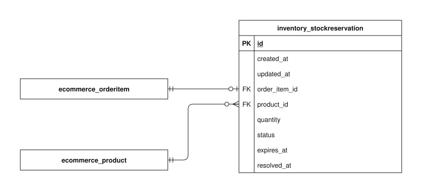

# Inventory data model

This guide explains the implemented `inventory` app schema in the checked-in Django models and migrations. It covers every concrete column of its 1 tables.

Open the SVG in Draw.io to edit its single `inventory` page. PK means primary key; FK means foreign key. A name-only rectangle references an entity owned by another app. A circle means zero, a bar means one, and a branching foot means many. The guide describes source code, not confirmation that migrations have been applied to a deployed database.

## Reading the fields

Field types and defaults below are Django definitions. Unless marked nullable, a column cannot store SQL null. `blank=True` permits empty input during field validation; it does not imply SQL null. ORM defaults are not promises of database-side SQL defaults. Constraints described as application validation can be bypassed by bulk/queryset writes or raw SQL. Foreign-key columns normally use the model attribute plus `_id`.

## Models

### StockReservation

The inventory held for one order item while online payment is unresolved.

**Table:** `inventory_stockreservation`. **Model:** `inventory.StockReservation`.

order_item_id is unique and quantity must be at least one. full_clean() verifies that the product and quantity match the order item. Both foreign keys use PROTECT even after the hold resolves. Saving this row alone does not lock stock, deduct inventory, or schedule expiration.

| Field / column                 | Meaning                                                                                          | Constraints and behavior                                                                             |
| ------------------------------ | ------------------------------------------------------------------------------------------------ | ---------------------------------------------------------------------------------------------------- |
| `id`                           | Internal identifier for this stored record.                                                      | BigAutoField; generated primary key.                                                                 |
| `created_at`                   | When this record was first inserted.                                                             | DateTimeField; not null; set on insertion.                                                           |
| `updated_at`                   | When this record was last saved through timestamp-aware ORM writes.                              | DateTimeField; not null; set on ORM save when included in the write.                                 |
| `order_item` → `order_item_id` | Purchased line whose inventory is held.                                                          | OneToOneField; not null; FK to `ecommerce_orderitem.id`; unique; PROTECT on referenced deletion.     |
| `product` → `product_id`       | Catalog product described by this row.                                                           | ForeignKey; not null; FK to `ecommerce_product.id`; PROTECT on referenced deletion.                  |
| `quantity`                     | Units held, required to match the referenced order item.                                         | PositiveIntegerField; not null.                                                                      |
| `status`                       | Whether the hold remains held, has been consumed by payment, or has been released.               | CharField, max 10 characters; not null; ORM default "held"; choices: `held`, `consumed`, `released`. |
| `expires_at`                   | Deadline requiring payment reconciliation; reaching it alone does not prove the provider failed. | DateTimeField; not null.                                                                             |
| `resolved_at`                  | When the hold was consumed or released.                                                          | DateTimeField; nullable; blank allowed by field validation.                                          |

## Relationships and external references

Each row states how many referenced records one local row can use, and how many local records one referenced record may have. Reverse optionality is based on schema enforcement, not on a service normally creating a child.

| Local column                               | Referenced entity     | Per local row / per referenced row | Deletion of referenced record |
| ------------------------------------------ | --------------------- | ---------------------------------- | ----------------------------- |
| `inventory_stockreservation.order_item_id` | `ecommerce_orderitem` | exactly one / zero or one          | PROTECT                       |
| `inventory_stockreservation.product_id`    | `ecommerce_product`   | exactly one / zero or many         | PROTECT                       |

External entities are name-only references in this diagram:

- `ecommerce_orderitem`: full definition in [ecommerce](ecommerce.md).
- `ecommerce_product`: full definition in [ecommerce](ecommerce.md).

## Persistence and lifecycle

Online placement creates a held reservation under product locks after checking physical stock minus all unresolved held quantities. A timestamp passing does not make an unresolved provider payment safe to release; the service continues counting held reservations until provider reconciliation resolves them.

Verified payment consumes holds and deducts physical stock atomically with order/payment/ledger updates. Confirmed terminal cancellation/expiry releases holds without treating an uncertain provider state as failure. resolved_at records that resolution. Catalog/cart APIs expose physical Product.stock rather than subtracting reservations themselves.

Protected product and order-item references preserve hold history even after resolution. Model validation checks consistency but is not a substitute for transactional service locking or provider verification.

## Implementation and related guides

- [Model definitions](../../../../backend/apps/inventory/models.py).
- [Schema migrations](../../../../backend/apps/inventory/migrations).
- [apps/checkout/services/placement.py](../../../../backend/apps/checkout/services/placement.py).
- [apps/checkout/services/online.py](../../../../backend/apps/checkout/services/online.py).
- [Stripe test checkout](../../specific-business-processes/checkout/demo-online-checkout.md).
- [Data-model and business-process index](../../README.md).
