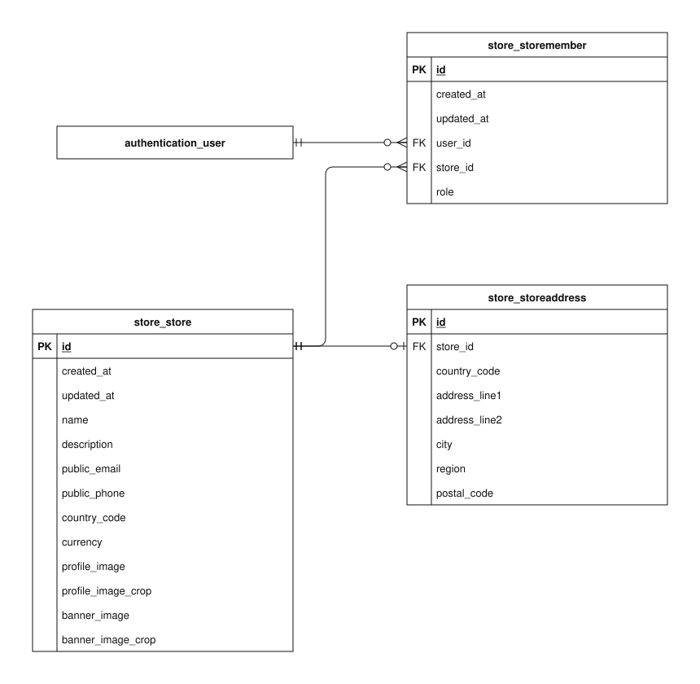

# Store data model

This guide explains the implemented `store` app schema in the checked-in Django models and migrations. It covers every concrete column of its 3 tables.

Open the SVG in Draw.io to edit its single `store` page. PK means primary key; FK means foreign key. A name-only rectangle references an entity owned by another app. A circle means zero, a bar means one, and a branching foot means many. The guide describes source code, not confirmation that migrations have been applied to a deployed database.

## Reading the fields

Field types and defaults below are Django definitions. Unless marked nullable, a column cannot store SQL null. `blank=True` permits empty input during field validation; it does not imply SQL null. ORM defaults are not promises of database-side SQL defaults. Constraints described as application validation can be bypassed by bulk/queryset writes or raw SQL. Foreign-key columns normally use the model attribute plus `_id`.

## Models

### Store

A seller’s public identity, contact details, images, and source pricing currency. Products and orders refer to this store.

**Table:** `store_store`. **Model:** `store.Store`.

The currency must match three uppercase letters at the database level. clean()/save() assign it from a supported country on creation and reject country/currency changes that would relabel existing store prices. New profile/banner uploads are compressed before saving.

| Field / column       | Meaning                                                             | Constraints and behavior                                                                          |
| -------------------- | ------------------------------------------------------------------- | ------------------------------------------------------------------------------------------------- |
| `id`                 | Internal identifier for this stored record.                         | BigAutoField; generated primary key.                                                              |
| `created_at`         | When this record was first inserted.                                | DateTimeField; not null; set on insertion.                                                        |
| `updated_at`         | When this record was last saved through timestamp-aware ORM writes. | DateTimeField; not null; set on ORM save when included in the write.                              |
| `name`               | Public store name used by browsing and copied into new orders.      | CharField, max 100 characters; not null.                                                          |
| `description`        | Public description of the seller’s business.                        | TextField; not null; blank allowed by field validation.                                           |
| `public_email`       | Business email address exposed to customers.                        | EmailField, max 254 characters; not null; blank allowed by field validation.                      |
| `public_phone`       | Business phone number exposed to customers.                         | CharField, max 40 characters; not null; blank allowed by field validation.                        |
| `country_code`       | Two-letter country code for this address or store.                  | CharField, max 2 characters; not null.                                                            |
| `currency`           | Source currency assigned from the store country for product prices. | CharField, max 3 characters; not null; not form-editable.                                         |
| `profile_image`      | Stored file name for the displayed profile image.                   | ImageField; not null; blank allowed by field validation.                                          |
| `profile_image_crop` | Saved crop metadata for displaying the profile image.               | JSONField; not null; blank allowed by field validation; ORM default {} (new object per instance). |
| `banner_image`       | Stored file name for the store’s banner image.                      | ImageField; not null; blank allowed by field validation.                                          |
| `banner_image_crop`  | Saved crop metadata for displaying the banner image.                | JSONField; not null; blank allowed by field validation; ORM default {} (new object per instance). |

### StoreAddress

The optional address record belonging to one store.

**Table:** `store_storeaddress`. **Model:** `store.StoreAddress`.

store_id is unique. Each address requires a store, while a store may have no address. Deleting the store cascades to its address.

| Field / column       | Meaning                                                                | Constraints and behavior                                                                 |
| -------------------- | ---------------------------------------------------------------------- | ---------------------------------------------------------------------------------------- |
| `id`                 | Internal identifier for this stored record.                            | BigAutoField; generated primary key.                                                     |
| `store` → `store_id` | Store that owns or participates in this record.                        | OneToOneField; not null; FK to `store_store.id`; unique; CASCADE on referenced deletion. |
| `country_code`       | Two-letter country code for this address or store.                     | CharField, max 2 characters; not null.                                                   |
| `address_line1`      | Primary street/building address used to locate the recipient or owner. | CharField, max 150 characters; not null.                                                 |
| `address_line2`      | Additional delivery or location detail, such as a unit or floor.       | CharField, max 150 characters; not null; blank allowed by field validation.              |
| `city`               | City or locality of the address.                                       | CharField, max 100 characters; not null.                                                 |
| `region`             | State, province, or other regional address component.                  | CharField, max 100 characters; not null; blank allowed by field validation.              |
| `postal_code`        | Postal routing code for the address.                                   | CharField, max 20 characters; not null; blank allowed by field validation.               |

### StoreMember

The explicit membership joining an account to a store with an admin or staff role. It implements Store.members without adding a members column to Store.

**Table:** `store_storemember`. **Model:** `store.StoreMember`.

The user/store pair is unique. A database check restricts role to admin or staff; the default is staff. Membership is a many-to-many association through this table, not a one-to-one relationship.

| Field / column       | Meaning                                                             | Constraints and behavior                                                                |
| -------------------- | ------------------------------------------------------------------- | --------------------------------------------------------------------------------------- |
| `id`                 | Internal identifier for this stored record.                         | BigAutoField; generated primary key.                                                    |
| `created_at`         | When this record was first inserted.                                | DateTimeField; not null; set on insertion.                                              |
| `updated_at`         | When this record was last saved through timestamp-aware ORM writes. | DateTimeField; not null; set on ORM save when included in the write.                    |
| `user` → `user_id`   | Account that owns or participates in this record.                   | ForeignKey; not null; FK to `authentication_user.id`; CASCADE on referenced deletion.   |
| `store` → `store_id` | Store that owns or participates in this record.                     | ForeignKey; not null; FK to `store_store.id`; CASCADE on referenced deletion.           |
| `role`               | Membership authorization role within the store: admin or staff.     | CharField, max 20 characters; not null; ORM default "staff"; choices: `admin`, `staff`. |

## Relationships and external references

Each row states how many referenced records one local row can use, and how many local records one referenced record may have. Reverse optionality is based on schema enforcement, not on a service normally creating a child.

| Local column                  | Referenced entity     | Per local row / per referenced row | Deletion of referenced record |
| ----------------------------- | --------------------- | ---------------------------------- | ----------------------------- |
| `store_storeaddress.store_id` | `store_store`         | exactly one / zero or one          | CASCADE                       |
| `store_storemember.user_id`   | `authentication_user` | exactly one / zero or many         | CASCADE                       |
| `store_storemember.store_id`  | `store_store`         | exactly one / zero or many         | CASCADE                       |

External entities are name-only references in this diagram:

- `authentication_user`: full definition in [authentication](authentication.md).

## Persistence and lifecycle

Store prices use the currency assigned from the store country. Changing that denomination would require an explicit price migration; ordinary saves reject relabeling it. Profile and banner uploads are compressed, and replacement/deletion signals remove unreferenced files after commit.

Membership role values are schema/authorization data, not proof that every seller operation is implemented. Products and purchase records use protected store references, so deleting a referenced store may be blocked even though memberships and its address cascade. Existing orders retain their own store-name and price snapshots.

## Implementation and related guides

- [Model definitions](../../../../backend/apps/store/models.py).
- [Schema migrations](../../../../backend/apps/store/migrations).
- [apps/store/signals.py](../../../../backend/apps/store/signals.py).
- [core/common/currencies.py](../../../../backend/core/common/currencies.py).
- [apps/store/services/catalog.py](../../../../backend/apps/store/services/catalog.py).
- [Cash on delivery](../../specific-business-processes/checkout/cod-checkout.md).
- [Stripe test checkout](../../specific-business-processes/checkout/demo-online-checkout.md).
- [Data-model and business-process index](../../README.md).
