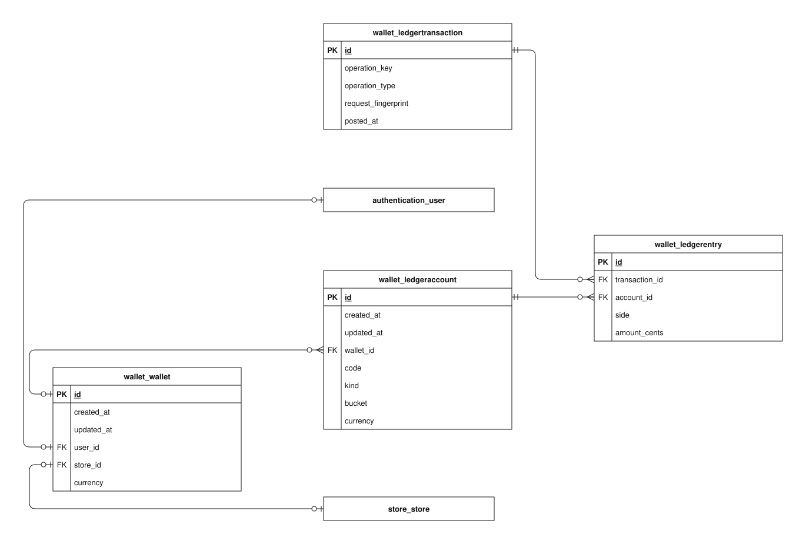

# Wallet data model

This guide explains the implemented `wallet` app schema in the checked-in Django models and migrations. It covers every concrete column of its 4 tables.

Open the SVG in Draw.io to edit its single `wallet` page. PK means primary key; FK means foreign key. A name-only rectangle references an entity owned by another app. A circle means zero, a bar means one, and a branching foot means many. The guide describes source code, not confirmation that migrations have been applied to a deployed database.

## Reading the fields

Field types and defaults below are Django definitions. Unless marked nullable, a column cannot store SQL null. `blank=True` permits empty input during field validation; it does not imply SQL null. ORM defaults are not promises of database-side SQL defaults. Constraints described as application validation can be bypassed by bulk/queryset writes or raw SQL. Foreign-key columns normally use the model attribute plus `_id`.

## Models

### LedgerTransaction

One completed, idempotent journal posting identified by a unique operation key and canonical request fingerprint.

**Table:** `wallet_ledgertransaction`. **Model:** `wallet.LedgerTransaction`.

operation_key is globally unique. Identical canonical postings replay the existing transaction; a reused key with a different fingerprint is rejected. Journal insertion must go through post_transaction(); ordinary journal saves and public queryset mutations are rejected.

| Field / column        | Meaning                                                                                          | Constraints and behavior                                              |
| --------------------- | ------------------------------------------------------------------------------------------------ | --------------------------------------------------------------------- |
| `id`                  | Internal identifier for this stored record.                                                      | BigAutoField; generated primary key.                                  |
| `operation_key`       | Globally unique business-operation identifier used for idempotent posting.                       | CharField, max 200 characters; not null; unique.                      |
| `operation_type`      | Audit label describing why the posting occurred.                                                 | CharField, max 60 characters; not null.                               |
| `request_fingerprint` | Canonical SHA-256 digest distinguishing identical posting replays from conflicting use of a key. | CharField, max 64 characters; not null.                               |
| `posted_at`           | When this immutable journal transaction was posted.                                              | DateTimeField; not null; ORM default current time; not form-editable. |

### Wallet

A simulated USD accounting identity owned by either a customer or a store. It has no editable balance column.

**Table:** `wallet_wallet`. **Model:** `wallet.Wallet`.

A database check requires exactly one of user_id/store_id, never both or neither; each individual owner reference is unique. Currency is constrained to USD. Ordinary saved wallet identities/ownership are immutable. These nullable one-to-one links are coupled by the exclusive-owner check.

| Field / column       | Meaning                                                             | Constraints and behavior                                                                                                            |
| -------------------- | ------------------------------------------------------------------- | ----------------------------------------------------------------------------------------------------------------------------------- |
| `id`                 | Internal identifier for this stored record.                         | BigAutoField; generated primary key.                                                                                                |
| `created_at`         | When this record was first inserted.                                | DateTimeField; not null; set on insertion.                                                                                          |
| `updated_at`         | When this record was last saved through timestamp-aware ORM writes. | DateTimeField; not null; set on ORM save when included in the write.                                                                |
| `user` → `user_id`   | Customer owner, present only when this is a customer wallet.        | OneToOneField; nullable; FK to `authentication_user.id`; unique; PROTECT on referenced deletion; blank allowed by field validation. |
| `store` → `store_id` | Store owner, present only when this is a store wallet.              | OneToOneField; nullable; FK to `store_store.id`; unique; PROTECT on referenced deletion; blank allowed by field validation.         |
| `currency`           | Accounting denomination; USD only.                                  | CharField, max 3 characters; not null; ORM default "USD"; not form-editable.                                                        |

### LedgerAccount

One accounting bucket for a wallet, or the platform’s ownerless treasury account. Balances are derived from entries.

**Table:** `wallet_ledgeraccount`. **Model:** `wallet.LedgerAccount`.

The wallet/bucket pair is unique; a conditional unique constraint permits one treasury account. Database checks require USD and either an ownerless treasury/asset account or a wallet-owned liability in pending, available, or withdrawal_pending. Ordinary identities cannot be changed after insertion.

| Field / column         | Meaning                                                                      | Constraints and behavior                                                                                           |
| ---------------------- | ---------------------------------------------------------------------------- | ------------------------------------------------------------------------------------------------------------------ |
| `id`                   | Internal identifier for this stored record.                                  | BigAutoField; generated primary key.                                                                               |
| `created_at`           | When this record was first inserted.                                         | DateTimeField; not null; set on insertion.                                                                         |
| `updated_at`           | When this record was last saved through timestamp-aware ORM writes.          | DateTimeField; not null; set on ORM save when included in the write.                                               |
| `wallet` → `wallet_id` | Owning wallet for liability buckets; absent for the platform treasury.       | ForeignKey; nullable; FK to `wallet_wallet.id`; PROTECT on referenced deletion; blank allowed by field validation. |
| `code`                 | Unique service-assigned accounting account identifier.                       | CharField, max 100 characters; not null; unique.                                                                   |
| `kind`                 | Asset or liability classification determining balance arithmetic.            | CharField, max 10 characters; not null; choices: `asset`, `liability`.                                             |
| `bucket`               | Purpose of the account: treasury, pending, available, or withdrawal_pending. | CharField, max 20 characters; not null; choices: `treasury`, `pending`, `available`, `withdrawal_pending`.         |
| `currency`             | Accounting denomination; USD only.                                           | CharField, max 3 characters; not null; ORM default "USD"; not form-editable.                                       |

### LedgerEntry

A debit or credit against one ledger account within a balanced transaction, expressed as positive integer USD cents.

**Table:** `wallet_ledgerentry`. **Model:** `wallet.LedgerEntry`.

The transaction/account pair is unique. amount_cents must be greater than zero and side must be debit or credit. The posting service enforces balanced totals and resulting balances across rows; individual row checks cannot enforce a balanced journal.

| Field / column                   | Meaning                                                                  | Constraints and behavior                                                                   |
| -------------------------------- | ------------------------------------------------------------------------ | ------------------------------------------------------------------------------------------ |
| `id`                             | Internal identifier for this stored record.                              | BigAutoField; generated primary key.                                                       |
| `transaction` → `transaction_id` | Journal posting containing this entry.                                   | ForeignKey; not null; FK to `wallet_ledgertransaction.id`; PROTECT on referenced deletion. |
| `account` → `account_id`         | Accounting bucket affected by this entry.                                | ForeignKey; not null; FK to `wallet_ledgeraccount.id`; PROTECT on referenced deletion.     |
| `side`                           | Debit or credit accounting direction, not a payment-card type.           | CharField, max 6 characters; not null; choices: `debit`, `credit`.                         |
| `amount_cents`                   | Positive integer USD cents assigned to this account in this transaction. | PositiveBigIntegerField; not null.                                                         |

## Relationships and external references

Each row states how many referenced records one local row can use, and how many local records one referenced record may have. Reverse optionality is based on schema enforcement, not on a service normally creating a child.

| Local column                        | Referenced entity          | Per local row / per referenced row | Deletion of referenced record |
| ----------------------------------- | -------------------------- | ---------------------------------- | ----------------------------- |
| `wallet_wallet.user_id`             | `authentication_user`      | zero or one / zero or one          | PROTECT                       |
| `wallet_wallet.store_id`            | `store_store`              | zero or one / zero or one          | PROTECT                       |
| `wallet_ledgeraccount.wallet_id`    | `wallet_wallet`            | zero or one / zero or many         | PROTECT                       |
| `wallet_ledgerentry.transaction_id` | `wallet_ledgertransaction` | exactly one / zero or many         | PROTECT                       |
| `wallet_ledgerentry.account_id`     | `wallet_ledgeraccount`     | exactly one / zero or many         | PROTECT                       |

External entities are name-only references in this diagram:

- `authentication_user`: full definition in [authentication](authentication.md).
- `store_store`: full definition in [store](store.md).

## Persistence and lifecycle

This is a simulated USD double-entry journal, not a bank account or customer payment method. create_wallet() locks an owner and creates its wallet and liability accounts atomically/idempotently. Treasury is lazily created. No real money moves.

post_transaction() accepts trusted internal postings, validates positive integer cents, distinct accounts, equal debit/credit sums, and resulting balances, then writes the transaction and entries atomically. It locks treasury first and affected accounts in ID order, serializing the demo journal. Identical operation-key/fingerprint replays return the existing posting; conflicts and invalid/insufficient balances fail. A failed insert or outer business transaction rolls back the posting. PostgreSQL row locks are required for the supported concurrent behavior.

Asset balances are debits minus credits; liabilities are credits minus debits. No editable balance field, floating-point accounting, or currency conversion belongs to this journal. Verified Stripe test receipts credit store pending accounts; confirmed refunds add compensating entries instead of rewriting history. COD creates no postings.

Public ORM/model guards reject financial updates/deletion and direct journal insertion. They are application protections, not database triggers; raw SQL/private ORM access can bypass them. Trusted integrations must use the posting service. Admin is inspection-only. Available/withdrawal_pending buckets exist, but settlement, withdrawals, customer spending, and real bank integration are not implemented.

## Implementation and related guides

- [Model definitions](../../../../backend/apps/wallet/models.py).
- [Schema migrations](../../../../backend/apps/wallet/migrations).
- [apps/wallet/services.py](../../../../backend/apps/wallet/services.py).
- [docs/architecture/wallet-ledger.md](../../../../backend/docs/architecture/wallet-ledger.md).
- [Stripe test checkout](../../specific-business-processes/checkout/demo-online-checkout.md).
- [Data-model and business-process index](../../README.md).
