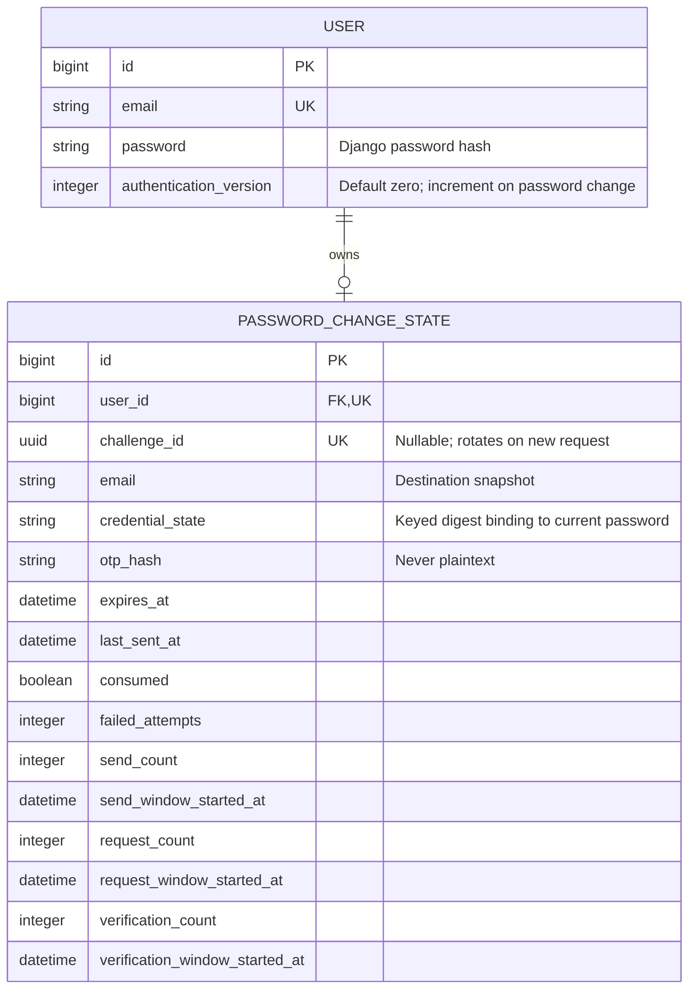

# Password-change challenge and session revocation

**Status:** Implemented model; apply authentication migration 0004 before use.
Registration OTPVerificationRecord remains independent.

This is the current password-change subset, not a replacement for the historical
full-system ERD. A one-to-one row is created lazily for each user. Challenge
replacement does not replace the row or reset its account budgets. User deletion
cascades to the state. No new password is stored until confirmation succeeds.

[Process and transaction boundaries](../specific-business-processes/account/change-password.md).

## Entities and relationship

### USER (`authentication.User`)

The account that owns the password-change challenge. Django's `AbstractUser`
provides the password and standard authentication fields; the application adds
email uniqueness and an authentication version for session invalidation.
This diagram shows only the fields needed to explain password changes, not every
column in the user model.

| Field / column | Meaning | Constraints and behavior |
| --- | --- | --- |
| `id` | Internal account identifier used to associate the challenge with its owner. | Primary key; generated by Django. |
| `email` | Account email address and login identifier. Password-change codes are sent to this address. | Unique email field. The challenge stores a snapshot so a later email change makes it unavailable. |
| `password` | Encoded Django password hash used to check the current password. | Never stores a plaintext password. Updated only after successful code confirmation and password validation. |
| `authentication_version` | Account version used to invalidate previously issued authentication tokens. | Non-negative integer, initially `0`. Incremented in the same transaction as a successful password change. |

### PASSWORD_CHANGE_STATE (`authentication.PasswordChangeState`)

A persistent challenge slot and rate-limit record belonging to one account.
The backend creates it lazily when a password-change operation first needs it.
A user can have no state row or exactly one; each state row belongs to exactly
one user. The database enforces this through the unique `user_id` foreign key,
and deleting the user cascades to the state row.

| Field / column | Meaning | Constraints and behavior |
| --- | --- | --- |
| `id` | Internal identifier of the persistent state row. | Generated bigint primary key. Remains the same when a challenge is replaced. |
| `user_id` | Owner of the challenge and its account-level limits. | Unique, required foreign key to `USER.id`; Django model field is named `user`. User deletion cascades to this row. |
| `challenge_id` | Public UUID identifying the current challenge in resend and confirmation requests. | Unique when present; nullable before a challenge is issued. A new request generates a new UUID, making the previous identifier unavailable. A resend keeps the current UUID. |
| `email` | Destination email captured when the challenge is issued. | Email field, initially empty. Must still match the account email for resend or confirmation. |
| `credential_state` | Keyed digest of the account's encoded password at challenge creation. | String of up to 64 characters, initially empty. Binds the challenge to the current credential without duplicating its reusable password hash; a mismatch makes the challenge unavailable. |
| `otp_hash` | Encoded hash used to verify the emailed one-time code. | String of up to 255 characters, initially empty. Each send replaces it; plaintext codes are not stored. Successful confirmation replaces it with an unusable hash. |
| `expires_at` | Deadline for confirming the current code. | Nullable datetime until a code is issued. Each send sets a new deadline; confirmation at or after it is rejected. |
| `last_sent_at` | Timestamp used to enforce the delay before another code can be requested. | Nullable datetime until a code is issued. Updated when the code is prepared and persisted, before email delivery; it does not prove delivery succeeded. |
| `consumed` | Indicates whether the challenge is unavailable for further use. | Boolean, initially `true`. A new challenge sets it to `false`; successful confirmation, too many wrong codes, or a credential/email mismatch sets it to `true`. Expiry is checked separately. |
| `failed_attempts` | Number of incorrect OTP checks against the challenge. | Non-negative small integer, initially `0`. A new challenge resets it; resending does not. Reaching the configured attempt limit consumes the challenge. |
| `send_count` | Account-level budget used when generating codes for initial requests and resends. | Non-negative integer, initially `0`. Incremented after request validation and the cooldown check. Survives challenge replacement and email-delivery failure; resets when its time window expires. |
| `send_window_started_at` | Start of the current code-send budget window. | Required datetime initialized when the row is created. Updated when an expired send window is reset. |
| `request_count` | Account-level budget for initial-request and resend operations. | Non-negative integer, initially `0`. Charged before password/challenge validation and cooldown checks, including operations subsequently rejected by those checks. Survives challenge replacement; resets when its window expires. |
| `request_window_started_at` | Start of the current request budget window. | Required datetime initialized when the row is created. Updated when an expired request window is reset. |
| `verification_count` | Account-level budget for confirmation operations. | Non-negative integer, initially `0`. Charged before challenge eligibility, expiry, OTP, and password validation. Survives challenge replacement; resets when its window expires. |
| `verification_window_started_at` | Start of the current confirmation budget window. | Required datetime initialized when the row is created. Updated when an expired verification window is reset. |

## Persistence and lifecycle notes

The backend locks the owning user and performs state changes inside a database
transaction. Expected validation and rate-limit failures are raised after saving
and committing the state, so applicable counters and challenge invalidation are
retained. A budget already at its limit rejects the operation without incrementing
that counter. Limit values, window length, code lifetime, and resend cooldown come
from backend settings rather than columns in these entities.

Code delivery happens after the state transaction commits. A delivery failure
therefore leaves the prepared challenge, cooldown, and used budgets persisted.
On successful confirmation, the password update, authentication-version increment,
and challenge consumption commit together. No proposed new password is persisted
in the challenge row.

Registration uses the separate `OTPVerificationRecord` model, which is outside
this diagram's scope and does not share these password-change budgets.

## Implementation references

Paths below are relative to the sibling backend repository:

- `apps/authentication/models.py` — entity definitions and field constraints.
- `apps/authentication/migrations/0004_user_authentication_version_passwordchangestate.py` — schema migration for the version and challenge state.
- `apps/account/services/password.py` — challenge lifecycle, budgets, validation, and transaction behavior.
